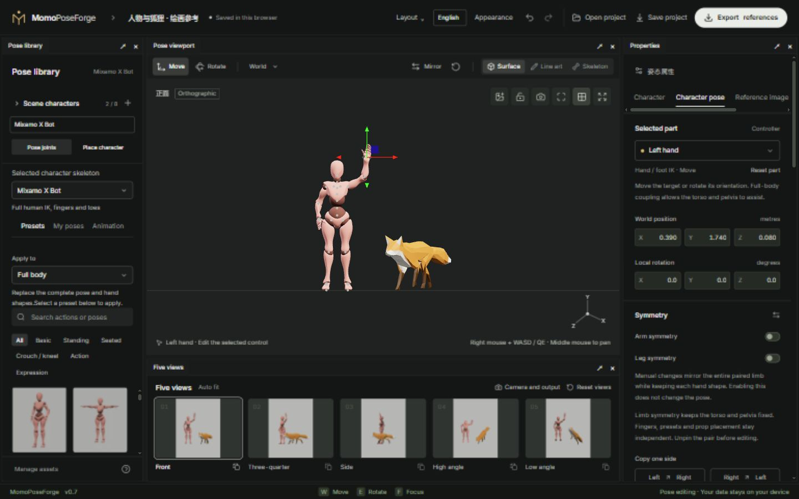

# MomoPoseForge

[简体中文](README.md) · [English](README.en.md)

Pose characters in your browser, compose scenes with people and a fox, and export drawing references or AI control images. Three.js renders the scene in real time; pose editing and file generation run locally in your browser.

**[Open editor](https://breezymomo.github.io/MomoPoseForge/) · [Illustrated manual](docs/README.en.md) · [Quick start](docs/01-quick-start.en.md) · [FAQ](docs/faq.en.md)**



## What you can do

- **Compose a scene** with up to 8 independent characters, including multiple instances of one rig and mixed human/fox scenes. Each keeps its pose, appearance, placement, pins, visibility and lock state.
- **Pose each rig using its supported controls**: X Bot / Y Bot human IK, fingers, hand poses and mirroring; BodyChan / BodyKun limb IK, FK, hand poses and bend direction; Fox paw IK and head, torso and tail FK.
- **Create drawing references** with presets, partial presets on supported rigs, line art, human construction guides, a reference image and basic prop contact helpers.
- **Capture animation frames** as editable static poses. The fox includes native clips; compatible Mixamo human FBX / GLB animation can be imported.
- **Replace a character appearance** with a compatible skinned GLB / FBX, and manage local character and motion resources.
- **Compose five shared views**, save camera bookmarks, change aspect ratio and resolution, and select true top/bottom directions.
- **Export useful channels**: shaded surfaces, line art, construction guides, skeletons, depth, normals and masks. X Bot / Y Bot provide human OpenPose; generic joints cover all visible characters.
- **Use poses in other 3D applications**: export a static posed GLB, or retain bones, skinning and a current-pose clip. Export the selected character or the visible scene with embedded textures.
- **Continue editing** with portable `.poseforge` projects, lightweight scene JSON, pose/hand favorites and undo/redo.
- **Arrange your workspace** with docking, splits, floating panels, saved layouts, themes, density and Chinese/English UI.

Rig capabilities differ: see [Rigs and posing](docs/02-posing-and-rigs.en.md). Animals are never encoded as human OpenPose. BodyChan / BodyKun currently have no human OpenPose, automatic full-body reaching or sole support.

## First session

1. Open the [editor](https://breezymomo.github.io/MomoPoseForge/) and select a character and rig on the left.
2. Start with a pose preset. Select a viewport control, then use **Move W / Rotate E** and the properties panel.
3. Expand **Scene characters** to add another instance. Use **Place character** to position the whole actor, then return to **Pose joints**.
4. Set the views and output frame, then choose **Export**.
5. Choose **Save project** and download a complete `.poseforge` for future editing.

Moving a supported hand, foot or paw uses IK; rotating a joint uses FK. Unpin an endpoint before moving it directly. Whole-character placement moves its pins too.

## Read by task

- [01 · Quick start](docs/01-quick-start.en.md)
- [02 · Rigs and posing](docs/02-posing-and-rigs.en.md)
- [03 · Characters and appearances](docs/03-scene-and-assets.en.md)
- [04 · Animation and references](docs/04-animation-and-reference.en.md)
- [05 · Cameras, five views and export](docs/05-camera-and-export.en.md)
- [06 · Workspace and saving](docs/06-workspace-and-storage.en.md)
- [FAQ](docs/faq.en.md) · [Development and GitHub Pages](docs/development.en.md)

The top **Help** menu offers a quick guide, illustrated manual, FAQ and GitHub repository. Documentation follows the UI language. The lower-left help shortcut also opens the controls guide. The HTML manual is built and deployed with the editor.

## Run locally

Use Node.js 24; verified with Node 24.13.1. The browser needs working WebGL2. A desktop browser and mouse are suitable for precise posing.

```sh
npm ci
npm run dev
```

Open [http://127.0.0.1:5173/](http://127.0.0.1:5173/). Run commands from the repository root.

```sh
npm run test:setup
npm test
npm run check:docs
npm run build
```

The static site is written to `dist/`. `npm run build:pages` builds the editor and manual below `/MomoPoseForge/`. A push to `main` triggers validation and Pages deployment; see [Development](docs/development.en.md).

Shared layout, appearance, language and UI motion come from `@momo/workbench`. Its fixed package is included in `vendor/`; a standalone clone only needs `npm ci`, without sibling framework or TextureForge repositories. Do not copy another machine's `node_modules/`. Stop the dev server and rerun `npm ci` if dependencies cannot resolve. Startup and build check the required framework files.

## Data, scope and credits

Drafts, favorites and imported resources live in this browser's site storage. Computers, browsers, ports and hosted URLs do not share them automatically. Clearing site data can remove local work; save complete projects for backup. The editor does not run an online AI model; exported control images are intended for external workflows.

Characters may overlap. Automatic inter-character contact, collision avoidance and arbitrary rig retargeting are not implemented. The fox has no human hand poses or sole support. Appearance import requires a compatible rig and does not auto-rig arbitrary models.

Character assets keep their respective licenses and credits:

- [X Bot](web/public/models/XBOT-ASSET.md) / [Y Bot](web/public/models/YBOT-ASSET.md): Adobe Mixamo characters and conversion notes.
- [Fox](web/public/models/fox/FOX-ASSET.md): model, rig, animation and scarf credits.
- [BodyChan / BodyKun](web/public/models/body-figures/BODY-FIGURES.md): vinchau's source assets, source-page CC0 declaration and conversion notes.

The existing [design](docs/product-design-v1.md), [implementation log](docs/implementation-v0.1.md), [references](docs/reference-tools-and-controls.md) and [AI export validation](docs/ai-export-workflow.md) are technical notes in Chinese.
