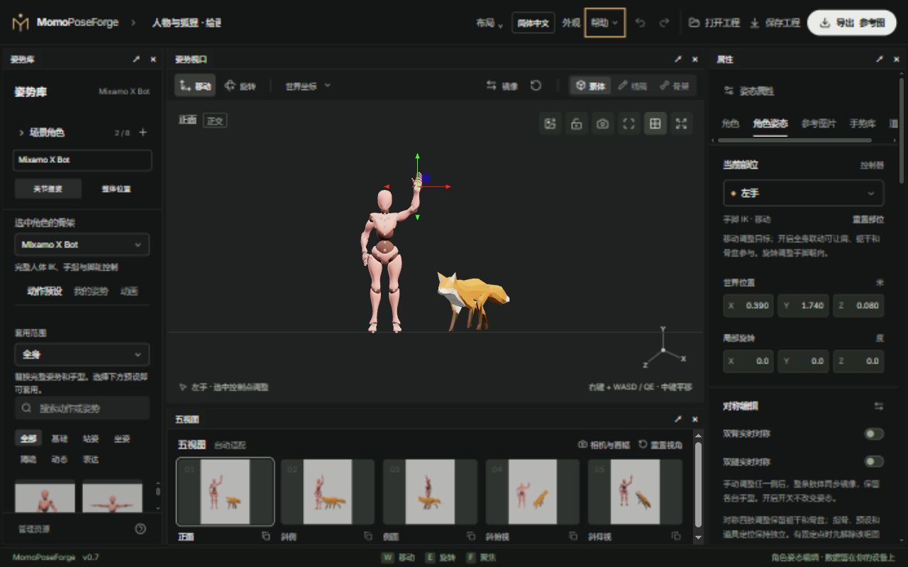

# MomoPoseForge

[简体中文](README.md) · [English](README.en.md)

在浏览器中摆出角色姿势，组合人物与小动物场景，再导出绘画参考和 AI 控制图。使用 Three.js 实时渲染，姿势编辑和文件生成在本机浏览器完成。

**[在线使用](https://breezymomo.github.io/MomoPoseForge/) · [图文用户手册](docs/README.md) · [快速上手](docs/01-quick-start.md) · [常见问题](docs/faq.md)**



## 可以做什么

- **多角色摆姿**：一个场景最多 8 个独立角色，人物、狐狸及同种角色的多个实例可以共存；分别管理姿势、外观、位置、朝向、固定点、显隐和锁定。
- **按骨架编辑**：X Bot / Y Bot 人体 IK、手指、手势与镜像；BodyChan / BodyKun 绘画素体的四肢 IK、FK、手势与肘膝朝向；Fox 四爪 IK 和头颈、躯干、尾巴 FK。
- **绘画参考**：动作预设、局部姿势套用（支持的骨架）、线稿与人体结构辅助线、参考图片对姿、道具接触辅助。
- **从动画取姿**：播放、暂停、逐帧选择并转成可继续编辑的静态姿势。狐狸内置动画；Mixamo 人体支持兼容的 FBX / GLB 动作导入。
- **切换外观**：在兼容的同一骨架上替换带蒙皮的 GLB / FBX 完整角色，管理本地角色和动画资源。
- **统一构图**：共享相机与五视图，保存相机书签、修改输出比例和分辨率，支持顶视、底视及自定义观察方向。
- **按用途交付**：素体、白模线稿、结构辅助线、骨架、深度、法线和遮罩；X Bot / Y Bot 输出人体 OpenPose，所有可见角色可输出通用关节数据。
- **带到其他 3D 软件**：导出静态摆姿 GLB，或保留骨架、蒙皮及当前姿态片段；支持选中角色和整个可见场景，贴图内嵌。
- **继续创作**：完整 `.poseforge` 工程携带自定义外观和选中的外部动作；轻量场景 JSON、姿势收藏、手势收藏与撤销/重做各有用途。
- **自己的工作台**：自由停靠、拆分、悬浮与保存布局，切换主题、密度和简体中文 / English。

各骨架能力不同，详见[骨架与摆姿](docs/02-posing-and-rigs.md)。动物不会编码为人体 OpenPose；BodyChan / BodyKun 暂不提供人体 OpenPose、全身自动够取或脚底支撑。

## 第一次使用

1. 打开[在线编辑器](https://breezymomo.github.io/MomoPoseForge/)，在左侧选择要编辑的角色和骨架。
2. 点一个**动作预设**作为起点，在视口点控制点，用 **移动 W / 旋转 E** 和右侧属性精调。
3. 需要多人时，展开**场景角色**添加实例；用**整体位置**摆放整个角色，再切回**关节摆姿**调整身体。
4. 调整五视图与画幅，点右上角**导出**生成参考图。
5. 点**保存工程**下载完整 `.poseforge`，保留以后继续编辑所需的资源。

拖动手脚会使用对应骨架的 IK；旋转关节是 FK。手脚固定后需先解除固定才能直接重新定位；**整体位置**会把角色与固定点一起搬动。

## 按任务阅读

- [01 · 快速上手](docs/01-quick-start.md)：认识界面、完成第一次摆姿和保存。
- [02 · 骨架与摆姿](docs/02-posing-and-rigs.md)：骨架能力、IK / FK、固定、肘膝朝向、手势和预设。
- [03 · 多角色与外观资源](docs/03-scene-and-assets.md)：添加角色、切骨架、摆放、换装和资源管理。
- [04 · 动画取姿与参考图](docs/04-animation-and-reference.md)：动作来源、导入、捕获帧、图片对姿与道具。
- [05 · 相机、五视图与导出](docs/05-camera-and-export.md)：观察、构图、线稿和 AI 控制数据。
- [06 · 工作台与保存](docs/06-workspace-and-storage.md)：布局、主题、语言、本地数据和跨设备工程。
- [常见问题](docs/faq.md) · [本地运行与 GitHub Pages 部署](docs/development.md)。

顶部**帮助**菜单提供使用说明、图文用户手册、常见问题与 GitHub 仓库入口；英文界面进入英文文档。左下角仍可快速打开操作说明。在线手册与编辑器一起构建和发布。

## 本地运行

使用 Node.js 24；本项目已在 Node 24.13.1 验证。浏览器需要可用的 WebGL2，桌面浏览器和鼠标适合精确摆姿。

```sh
npm ci
npm run dev
```

访问 [http://127.0.0.1:5173/](http://127.0.0.1:5173/)。命令从仓库根目录运行。

```sh
npm run test:setup
npm test
npm run check:docs
npm run build
```

普通静态网站输出到 `dist/`；`npm run build:pages` 为 `/MomoPoseForge/` 子路径构建编辑器和 HTML 手册。推送 `main` 后，GitHub Actions 验证并部署到 Pages，详见[开发与部署](docs/development.md)。

布局、外观、多语言和界面动效来自独立的 `@momo/workbench`。固定版本的包已随仓库放在 `vendor/`，独立克隆后 `npm ci` 即可安装，不需要旁边存在 MomoWorkbench 或 TextureForge。跨电脑不要复制 `node_modules/`；若依赖解析失败，停止服务后重新执行 `npm ci`。启动和构建前会检查所需框架文件。

## 数据、能力与素材说明

草稿、收藏和导入资源保存在当前浏览器站点的数据中。不同电脑、浏览器、端口和在线地址不自动共享；清理站点数据可能丢失本地内容，请保存完整工程备份。工具不包含在线 AI 推理服务，导出的控制图和数据供外部工作流使用。

角色可手动重叠；当前不提供角色间自动接触、碰撞避让或任意骨架自动重定向。狐狸没有人体手势或脚底支撑。换装要求骨架兼容，不能将任意模型自动变成可控角色。

角色资产按各自来源和许可使用，并保留随仓库提供的署名说明：

- [X Bot](web/public/models/XBOT-ASSET.md) / [Y Bot](web/public/models/YBOT-ASSET.md)：Adobe Mixamo 角色及相应转换说明。
- [Fox](web/public/models/fox/FOX-ASSET.md)：模型、骨骼、动画和围巾修改的许可与署名。
- [BodyChan / BodyKun](web/public/models/body-figures/BODY-FIGURES.md)：vinchau 原始素材、源页面 CC0 声明及转换说明。

[产品设计](docs/product-design-v1.md) · [实现与验证记录](docs/implementation-v0.1.md) · [同类工具参考](docs/reference-tools-and-controls.md) · [AI 导出验证](docs/ai-export-workflow.md)
