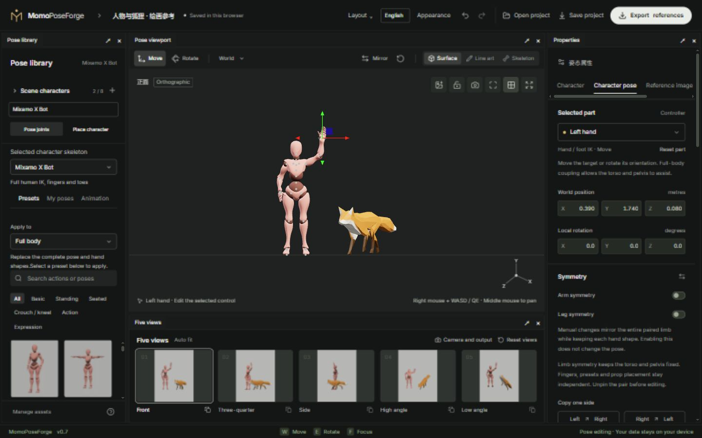
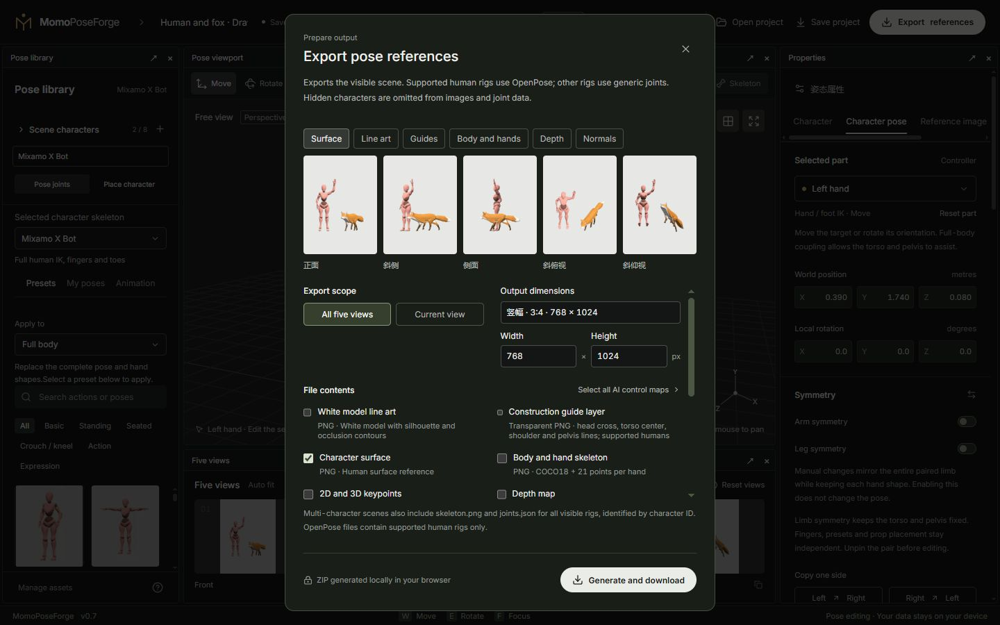

# 01 · Quick start

[简体中文](01-quick-start.md) · [English](01-quick-start.en.md)

[Manual](README.en.md) · Next: [Rigs and posing](02-posing-and-rigs.en.md)

## 1. Meet the workspace

Open the [editor](https://breezymomo.github.io/MomoPoseForge/). A fresh visit loads the default human; an existing local draft restores the previous scene.

- **Top bar**: project name, layout, language, appearance, undo/redo, open/save and export.
- **Pose library**: scene characters, selected actor's rig, presets, favorites and animation.
- **Viewport**: select controls, move or rotate joints and inspect the scene.
- **Five views**: five output directions of the same scene. Select a thumbnail to inspect it in the main viewport.
- **Properties**: appearance, body parts, pins, hand poses, reference image and props.

Use the top **Layout** menu if your panels differ. Narrow screens place some panels behind tabs. A desktop mouse makes precise posing easier.

## 2. Start from a preset

1. Choose X Bot, Y Bot, BodyChan, BodyKun or Fox using the selected character's rig selector.
2. Choose a pose preset; human presets can be searched and filtered.
3. Select a viewport control or use the body-part list in Properties.
4. Press **W** for Move and drag an axis, or **E** for Rotate and drag a ring.
5. Refine numeric values on the right. **Ctrl Z** undoes a drag; **Ctrl Shift Z** redoes it.

Supported hand/foot IK bends the limb with its endpoint. Heads, spines, tails and fingers are generally rotated with FK. See [Rigs and posing](02-posing-and-rigs.en.md) for actual capabilities.

## 3. Navigate and place characters

**Camera**: hold the right mouse button inside the viewport, look with the mouse and move with WASD. Q moves down, E moves up, Shift speeds up. Release the button to restore W/E posing shortcuts. Middle-drag pans, the wheel zooms, and F focuses.

**Whole actor**: select **Place character** in Scene characters to move the actor or adjust its heading; pins move with it. Return to **Pose joints** to edit the body. Moving the pelvis is different: it tries to retain hand/foot support.

## 4. Save an editable project

1. Name the project in the top bar.
2. Choose **Save project** and the complete `.poseforge` format.
3. Select external animation clips to include, if any, and download.
4. On another device, choose **Open project** and select that file.

Automatic drafts belong to this browser and site. Lightweight JSON does not carry custom appearance files. Prefer a complete project when switching devices.

## 5. Export references

1. Check the five views for cropping.
2. Choose **Export**, set the current/five views, output dimensions and channels.
3. Use shaded surfaces or line art for drawing. Choose skeleton, depth or normals when your external AI workflow needs them.
4. Download and extract the ZIP. Save a project separately to retain editing resources.

Next: [Rigs and posing](02-posing-and-rigs.en.md) · [Choosing export channels](05-camera-and-export.en.md)
