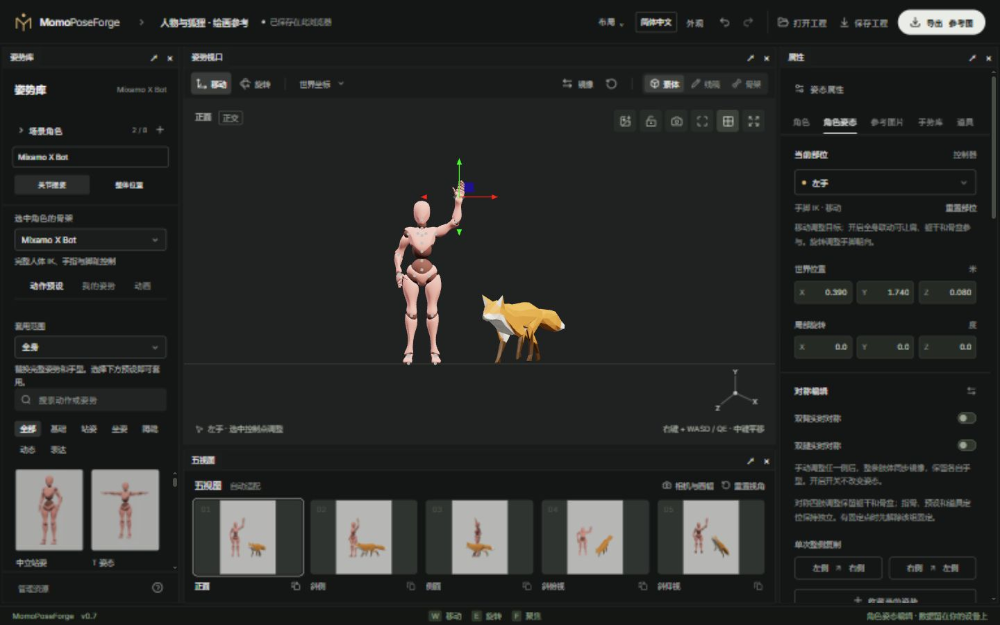
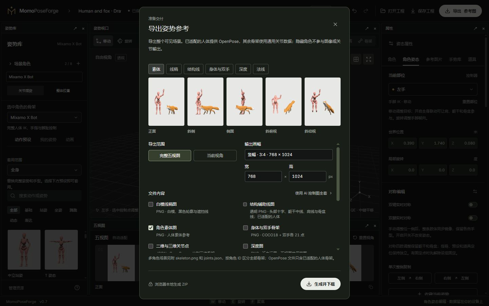

# 01 · 快速上手

[简体中文](01-quick-start.md) · [English](01-quick-start.en.md)

[手册目录](README.md) · 下一篇：[骨架与摆姿](02-posing-and-rigs.md)

## 1. 认识工作台

打开[在线编辑器](https://breezymomo.github.io/MomoPoseForge/)。首次使用会载入默认人体；已有本地草稿时会恢复上次场景。

- **顶栏**：工程名称、布局、语言、外观、撤销/重做、打开/保存工程和导出。
- **左侧姿势库**：场景角色、选中角色的骨架、动作预设、收藏与动画。
- **中间姿势视口**：选择控制点、移动或旋转关节、观察整个场景。
- **五视图**：同一场景的五个输出方向；点缩略图可在主视口查看。
- **右侧属性**：当前角色外观、身体部位、固定点、手势、参考图片与道具。

如果面板与图片不同，先从顶部**布局**选择适合的布局。窄屏会将部分面板收进标签页；需要精细拖动时使用桌面鼠标。

## 2. 从一个预设开始

1. 在左侧**选中角色的骨架**选择 X Bot、Y Bot、BodyChan、BodyKun 或 Fox。
2. 在**动作预设**中选择一个动作。人体可以用搜索和分类缩小范围。
3. 点视口中的控制点，右侧会切换到对应部位；也可以直接从右侧部位列表选择。
4. 用 **W** 切到移动，拖动彩色轴；用 **E** 切到旋转，拖动旋转环。
5. 用右侧数值精调。一个拖动操作可通过 **Ctrl Z** 撤销，**Ctrl Shift Z** 重做。

支持 IK 的手脚会带动上臂/大腿与肘膝弯曲；头、脊柱、尾巴和手指通常用旋转调整。不同骨架有不同的约束和控制入口，见[骨架与摆姿](02-posing-and-rigs.md)。

## 3. 移动镜头与摆放角色

**镜头**：在视口按住右键，移动鼠标转向，按 WASD 移动，Q 下降、E 上升，Shift 加速；松开右键后 W/E 恢复摆姿工具。中键平移，滚轮缩放，F 聚焦。

**角色整体**：在**场景角色**切到**整体位置**，移动或调整水平朝向；固定点会一起移动。切回**关节摆姿**再调整身体。整体摆放与移动骨盆的含义不同：骨盆移动会尝试保留脚或手的支撑。

## 4. 保存可继续编辑的工程

1. 在顶栏输入工程名称。
2. 点**保存工程**，选择完整 `.poseforge` 工程包。
3. 使用外部动画时，选择要一起携带的片段，然后下载。
4. 在另一设备用**打开工程**选择这个文件，继续编辑。

自动草稿只在当前浏览器站点中恢复。轻量 JSON 不包含自定义外观源文件；跨设备优先使用完整工程包。

## 5. 导出第一组参考图

1. 调整五视图，确认身体没有出框。
2. 点右上角**导出**，选择当前视角或五视图、输出尺寸与所需通道。
3. 绘画参考可选择素体或白模线稿；需要送给其他 AI 时再选择相应骨架、深度或法线通道。
4. 下载并解压 ZIP。输出图片用于参考；要继续编辑仍应保存工程。

下一步：[骨架与摆姿](02-posing-and-rigs.md) · [导出通道怎么选](05-camera-and-export.md)
