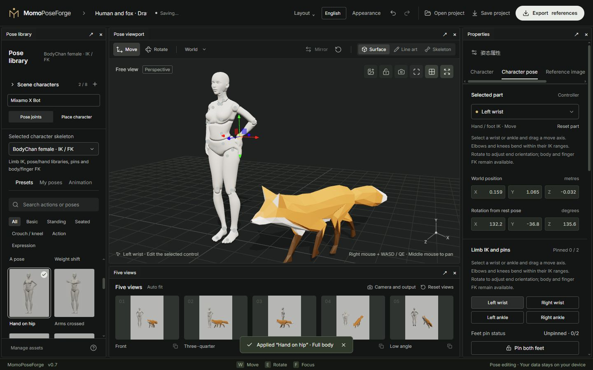

# 02 · Rigs and posing

[简体中文](02-posing-and-rigs.md) · [English](02-posing-and-rigs.en.md)

[Manual](README.en.md) · [Quick start](01-quick-start.en.md)

## Choose a rig

| Rig | Supported controls | Current limits |
| --- | --- | --- |
| X Bot | Human full-body IK, hands/feet, fingers, hand poses, mirroring, partial presets, sole support, OpenPose | Sole measurements use the original mesh; replacement shoes may differ |
| Y Bot | Human full-body IK, hands/feet, hand poses, mirroring, partial presets, OpenPose | No calibrated flat/forefoot support |
| BodyChan / BodyKun | Limb IK, pins, 53-joint FK, pose and hand libraries, bend direction, construction guides | No automatic full-body reaching, sole support, human OpenPose or arbitrary retargeting |
| Fox | Paw IK and pins; head, torso, legs and tail FK; native animation capture | No human hands/OpenPose, automatic full-body reaching or physical sole contact |

Unavailable controls are not hidden general-purpose features. The legacy basic human and experimental drawing mannequin remain readable for old projects but are not offered for new actors.

## Use IK and FK together

**IK (inverse kinematics)** moves a hand, foot or paw target and solves the preceding joints. Use it to decide where the endpoint belongs.

**FK (forward kinematics)** rotates a joint and carries its descendants with it. Use it for the head, spine, fingers, tail and final refinements. They are complementary controls.

1. Select the correct actor and **Pose joints** mode.
2. Select a viewport control or a body part in Properties.
3. Move IK endpoints; rotate FK joints.
4. Inspect world position and rotation relative to the rig's own rest pose. Numeric rotations cannot be copied blindly between different rigs.

Joint limits constrain bending, and targets can be unreachable. Shorten the reach and read the message instead of repeatedly increasing values.

## Pins and body motion

Select a hand, foot or paw in the pin section. Pin its position, and optionally its orientation. The UI distinguishes no, partial and full pinning and shows the count.

- Unpin an endpoint before dragging it or entering a new position directly.
- Position-only pins still allow rotation; orientation pins block direct rotation too.
- Moving the pelvis/root tries to retain support within the rig's reach and constraints.
- **Place character** transforms the entire actor, including pins. It does not simulate planted feet while moving the body.

X Bot / Y Bot **Full-body IK** can involve the shoulder, torso and pelvis for distant targets. Pins and limits retain priority. Other rigs do not automatically inherit that solver.

## Sole support

X Bot supports independent free, flat-foot and forefoot modes, with 0–45° heel lift. Measured sole points and existing pins/IK retain contact; this is not physics or collision detection.

Whole-character placement can move a supported foot above ground. Reapply contact or release support. Full-body presets and captured animation poses rebuild the pose and release prior sole support. Y Bot, drawing figures and Fox do not use X Bot's sole calibration.

## Bend direction and hand poses

**Elbow / knee direction** changes the bend plane while preserving wrist/ankle position and orientation, including pinned endpoints. Out-of-limit changes retain the previous pose. A perfectly straight limb has no stable bend plane; bend it slightly first.

For human hands, select left/right, apply a hand pose, copy it to the opposite hand, save a favorite or open the close-up view. Individual finger joints can be refined. Hand poses affect that hand rather than the whole body. Fox has no hand library.

## Presets, symmetry and reset

X Bot / Y Bot offer full-body, upper-body, lower-body and head preset scopes. For example, apply a sitting preset to the whole actor, then a waving preset to the upper body. Cards show the full preset even when only part is applied. Unpin conflicting endpoints first.

Supported human rigs can use live arm/leg symmetry or a single side copy. Live symmetry preserves each hand's shape and rejects operations that conflict with pins. BodyChan / BodyKun and Fox use their own exposed capabilities rather than the human mirroring strategy.

**Reset part** affects the selected part; the viewport reset restores the neutral pose. When the entire actor is tilted, **Upright character** removes its overall pitch/roll while retaining heading and local pose, with undo support.

Next: [Characters and appearances](03-scene-and-assets.en.md)
