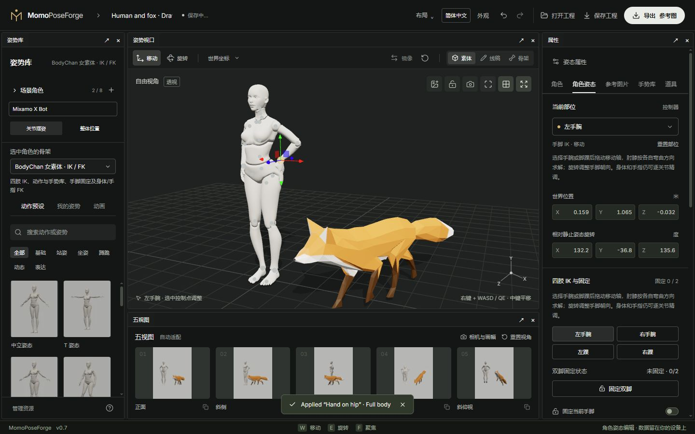

# 02 · 骨架与摆姿

[简体中文](02-posing-and-rigs.md) · [English](02-posing-and-rigs.en.md)

[手册目录](README.md) · [快速上手](01-quick-start.md)

## 选择适合的骨架

| 骨架 | 适合的编辑方式 | 当前边界 |
| --- | --- | --- |
| X Bot | 人体全身联动、手脚 IK、手指与手势、镜像、局部预设、脚底支撑、OpenPose | 脚底按原模型标定，换鞋外观可能有偏差 |
| Y Bot | 人体全身联动、IK、手势、镜像、局部预设、OpenPose | 没有 X Bot 的平脚/前掌支撑标定 |
| BodyChan / BodyKun | 四肢 IK、手脚固定、53 关节 FK、动作与手势、肘膝朝向、绘画结构线 | 无全身自动够取、脚底支撑、人体 OpenPose 或任意动作迁移 |
| Fox | 四爪 IK、固定点，头颈、躯干、腿和尾巴 FK；内置动画取姿 | 无人体手势、人体 OpenPose、自动全身够取或真实脚底接触 |

未开放的入口不是隐藏的通用能力。旧基础人形和绘画女素体试验模型仅用于已有工程兼容，不出现在常规新增列表。

## 看控制点颜色选择操作

视口左下角显示控制点图例：**蓝色可移动、橙色仅旋转、灰色已固定**。选中点保留其类型颜色，并以放大和白色外圈强调；右侧部位列表旁的圆点使用相同颜色。

颜色读取当前骨架实际开放的操作，不根据关节名称猜测。例如 X/Y Bot 的肘膝可以用位置控制调整弯曲朝向；Fox 和男女素体中未开放位置控制的中间关节显示为橙色。固定点和处于脚底支撑的脚趾显示灰色；解除固定后恢复对应颜色。仅固定位置时仍可能旋转，能否旋转取决于方向固定和当前骨架。

## IK 与 FK 怎么用

**IK（反向运动学）**：移动手、脚或爪子的目标位置，由求解器调整前面的关节。适合先确定“手放哪里、脚踩哪里”。

**FK（正向运动学）**：直接旋转关节，它后面的子关节会一起运动。适合调头部、胸腰、手指和尾巴，也适合给 IK 结果补细节。两者是不同控制方式，可以配合使用。

1. 先确认左侧选中了正确角色，且处于**关节摆姿**。
2. 从视口或右侧部位列表选择关节。
3. 手脚优先用移动确定位置；FK 部位用旋转。
4. 微调时观察右侧世界位置与相对静止姿态旋转。旋转值以该骨架自身的静止姿态为基准，不能跨骨架照抄数值。

关节限位会限制不合理弯曲，目标也可能超出可达范围。若拖动没有生效，先缩短目标距离并查看提示，不要反复加大数值。

## 固定点与身体移动

在固定区选择手脚或爪子，开启固定；需要时勾选**同时固定方向**。状态会显示未固定、部分固定或已固定，以及固定点数量。

- 固定后，末端不能直接拖动或输入新位置；先解除固定才能重新定位。
- 仅固定位置时仍能旋转；同时固定方向后也不能直接旋转。
- 移动骨盆或根部会在当前骨架能力范围内保留固定点，超出可达范围会受限。
- **整体位置**表示搬动整个角色，会把固定点一起变换，不是让角色拖着脚移动。

X Bot / Y Bot 的**全身联动**允许远端目标带动肩、躯干和骨盆，固定和限位优先。其他骨架不自动获得这一能力。

## 脚底支撑

X Bot 可分别给左右脚选择自由、平脚贴地或前掌支撑，抬跟角度为 0–45°。它利用脚底采样点与原有固定/IK 保持接触，不是碰撞或物理模拟。

整体摆放离地后可能显示接触偏差；重新落地或解除支撑即可。全身预设或动画取姿会重新建立姿势并解除原支撑。Y Bot、绘画素体和狐狸尚未启用这套脚底标定。

## 肘膝朝向与手势

在**肘膝朝向**中改变弯曲平面，可保留手腕/脚踝的位置和朝向；固定末端仍可使用。超限会保留原姿势。完全伸直时没有稳定弯曲平面，先稍微弯曲再调方向。

人体手势库可选左手/右手，再套用手势、复制到另一手、收藏自己的手型或打开手部近景。手指还能逐节精调。手势只修改所选手，不替代整个身体动作；狐狸没有手势入口。

## 预设、对称与重置

X Bot / Y Bot 可选择全身、上半身、下半身或头部范围再应用预设。例如先全身套用坐姿，再用上半身套用挥手。预设卡片仍展示完整动作，实际只应用当前范围；与固定点冲突时先解除固定。

支持镜像的人体可分别开启双臂或双腿实时对称，也可使用单次整侧复制。实时对称保留各自手型；有固定冲突时整次操作不会执行。BodyChan / BodyKun 与 Fox 的能力按各自入口提供，不套用人体镜像策略。

**重置部位**只重置所选部位；工具栏重置恢复中立姿态。选中角色整体倾斜时，**扶正角色**清除整体俯仰和侧倾，保留水平朝向及局部姿势，可撤销。

下一步：[多角色与外观资源](03-scene-and-assets.md)
