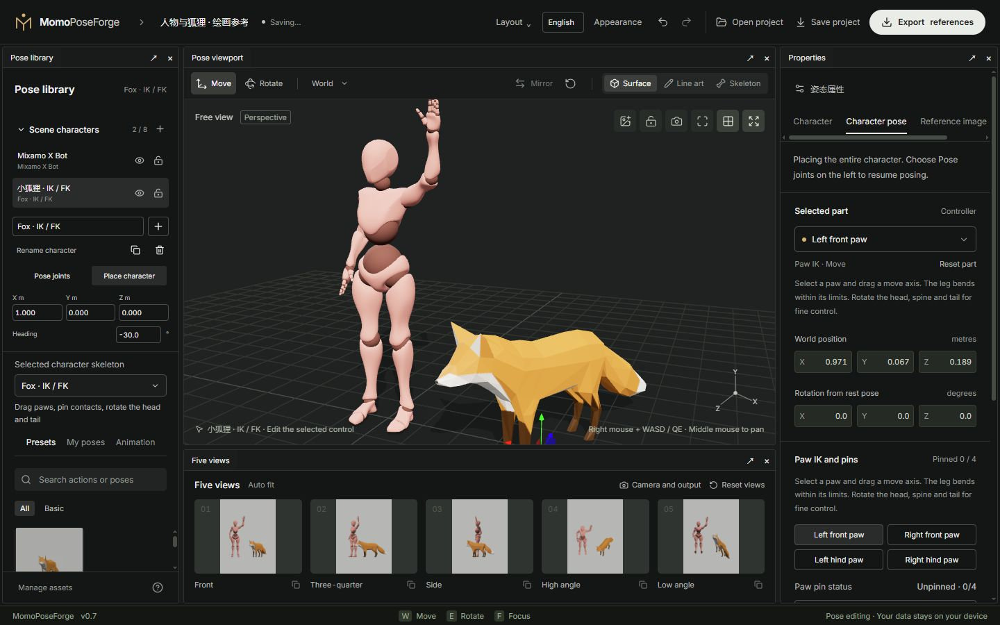

# 03 · Characters and appearances

[简体中文](03-scene-and-assets.md) · [English](03-scene-and-assets.en.md)

[Manual](README.en.md) · [Rigs and posing](02-posing-and-rigs.en.md)

## Add and select actors

Expand **Scene characters**, choose a rig and add it. Up to 8 independent instances can coexist, including people, foxes and repeated rigs. The collapsed section retains a quick selector.

Choose an actor in the list or click its selectable surface in the viewport. Properties, presets, appearance and animation now target that instance. Duplicate creates an independent static-pose copy. Removal supports undo; at least one actor remains.

## Placement, visibility and locking

Switch to **Place character** and use the gizmo or position/heading fields. Whole-character rotation primarily adjusts heading; return to **Pose joints** for individual joints.

- **Hidden** actors stay in the project but are omitted from image and joint exports.
- **Locked** actors still render and export, while editing controls are disabled.
- **Rename** changes the actor name without changing its rig/resource identity.

Cameras, lighting, ground, five views, reference image and props are shared. Depth, normal and mask images preserve mutual occlusion. Actors can intersect; there is no automatic handshake, hug or collision avoidance.

## Switch the rig

The selected character's rig selector replaces only that actor. Other actors remain intact. This session caches that actor's poses for previously used rigs; switching back can restore them. Projects save each actor's current rig and pose, not all alternate rig caches.

Rigs differ in joints, proportions and constraints. Switching is not automatic animation retargeting. Add another instance if you want to keep both characters.

## Replace an appearance

1. Select the actor and open **Character** in Properties.
2. Choose a built-in appearance or import a complete GLB / FBX, up to 32 MiB.
3. The file must match the current rig's bone names/hierarchy, use skinned surfaces/clothing and embed its textures.
4. Continue posing after a successful import; the control rig and pose remain.

Import replaces the whole appearance rather than layering individual garments. Export the body and all desired clothing together. Human appearances need a compatible Mixamo hierarchy; Fox requires its own rig. Arbitrary FBX meshes, unskinned objects and VRM are not auto-rigged.

## Manage local resources

Open **Manage assets** from the library footer or Character panel. Browse appearances and external clips by rig, rename them, move them to trash and restore them. Built-in appearances are read-only. Deleting an active clip exits its preview. Appearance source bytes remain available for existing references and undo; trash is not permanent browser-storage removal.

The library belongs to this browser's site storage. Use a [complete project](06-workspace-and-storage.en.md) to move custom characters and clips to another device.

Next: [Animation and references](04-animation-and-reference.en.md)
