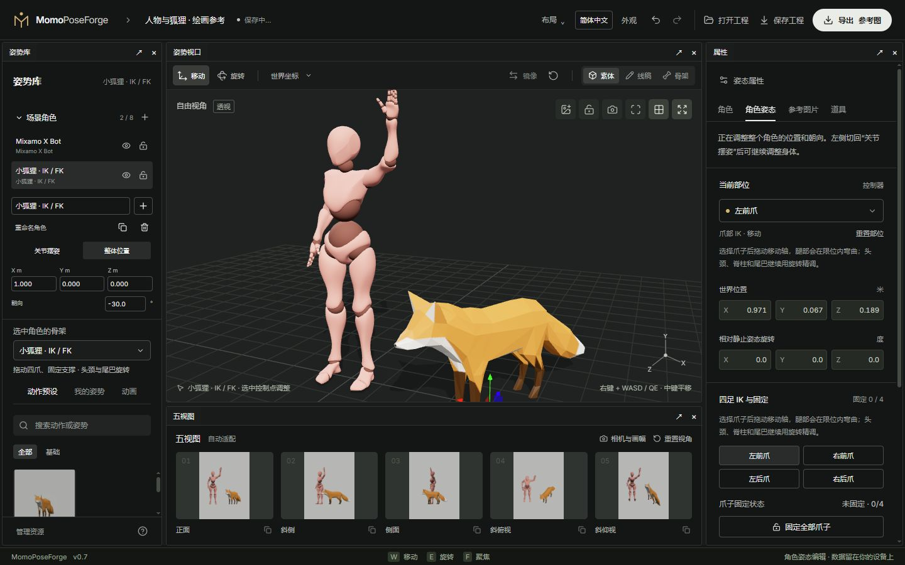

# 03 · 多角色与外观资源

[简体中文](03-scene-and-assets.md) · [English](03-scene-and-assets.en.md)

[手册目录](README.md) · [骨架与摆姿](02-posing-and-rigs.md)

## 添加和选择角色

展开左侧**场景角色**，选择骨架后点添加。最多 8 个角色，可以是多个人、多只狐狸或混合场景。列表折叠时仍可通过下拉框快速选择。

点击角色列表或视口中的可选角色表面切换实例。选中后，右侧属性、左侧预设、外观与动画入口都对应这个实例。复制创建独立的静态姿势副本；移除可撤销，场景至少保留一个角色。

## 整体摆放、隐藏与锁定

切到**整体位置**，用视口坐标轴或左侧位置与朝向数值摆放整个角色。整体旋转以水平朝向为主，关节旋转请回到**关节摆姿**。

- **隐藏**的角色保留在工程中，但不参与图像和关节数据导出。
- **锁定**的角色仍显示和参与导出，编辑入口被禁用，防止误动。
- **重命名**只修改实例名称，不更换骨架或资源标识。

所有角色共享相机、灯光、地面、五视图、参考图和道具。深度、法线和遮罩会保留角色间的真实遮挡；角色之间允许重叠，不会自动握手、拥抱或避让。

## 切换骨架

**选中角色的骨架**只替换当前实例；其他实例不变。当前会话为这个实例缓存各骨架的姿势，切回时可恢复；工程只保存各实例当下使用的骨架与姿势，不保存全部候选骨架缓存。

不同骨架的关节数、比例和约束不同，切换不等于把原动作自动重定向到另一种身体。需要保留两种角色时，优先新增或复制实例。

## 在同一骨架上换外观

1. 选中要换装的角色，打开右侧**角色**页签。
2. 选择内置外观，或导入 GLB / FBX 完整角色，文件不超过 32 MiB。
3. 导入资源需要匹配当前骨架的骨名和层级，角色/服装已蒙皮，贴图内嵌。
4. 导入成功后继续摆姿；原姿势和控制骨架保留。

这是完整外观替换，不是服装分层叠加。请把需要一起显示的人物与服装一起导出。人体接受兼容的 Mixamo 层级，狐狸必须匹配狐狸骨架；不支持把任意 FBX、未蒙皮网格或 VRM 自动变成兼容角色。

## 管理本地资源

从姿势库底部或角色页打开**管理资源**，按骨架查看外观与外部动作，可重命名、删除到回收站和恢复。内置外观只读；删除当前动作会退出相应预览。外观的源文件会为已有工程引用和撤销保留，回收站不等于彻底清空浏览器存储。

资源库只在当前浏览器站点中存在。让另一台电脑获得自定义外观和动作，使用[完整工程包](06-workspace-and-storage.md)。

下一步：[动画取姿与参考图](04-animation-and-reference.md)
