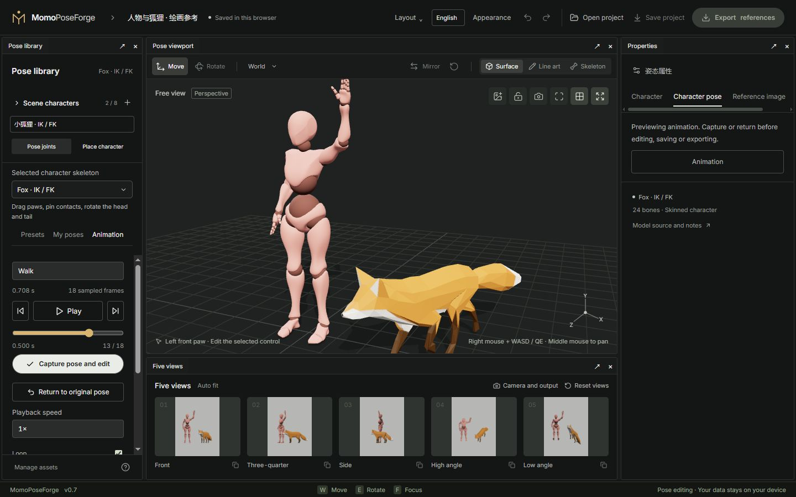

# 04 · Animation and references

[简体中文](04-animation-and-reference.md) · [English](04-animation-and-reference.en.md)

[Manual](README.en.md) · [Characters and resources](03-scene-and-assets.en.md)

## Animation sources

- **Fox native clips**: Survey, Walk and Run are included with the model.
- **External human clips**: X Bot / Y Bot accept compatible Mixamo-hierarchy FBX / GLB animations. Supply your own files or files you have permission to use; the site does not download Mixamo content automatically.
- **BodyChan / BodyKun**: use presets, hand poses and manual posing. External human motion retargeting is not currently available.

Animation import reads motion. **Character appearance import** replaces surfaces and clothing. Arbitrary motion mapping across different rigs is not implemented.

## Capture a frame

1. Select the actor and open **Animation** in the left panel.
2. Select a native clip, or import FBX / GLB on a supported human rig.
3. Play, pause and choose a frame using the slider or previous/next frame buttons.
4. Choose **Capture pose and edit** below playback to turn that frame into an editable static pose.
5. Continue with IK / FK, then save the project.

**Return to original pose** cancels preview and restores the pose from before playback. Pausing alone does not capture the pose. Switching actors or rigs ends an uncaptured preview.

Motion resources and sampling state belong to each actor, but only the selected actor is previewed. This is a static pose capture workflow, not a multi-character timeline or animation editor. Human import adapts to the canonical rig while retaining its bone lengths; all source deformation is not guaranteed to match. **In-place playback** controls root translation.

## Use a reference image

Open the viewport image control or **Reference image** in Properties. Import PNG, JPEG or WebP up to 10 MB. Adjust opacity, uniform scale and position, then lock the reference layer before posing.

This shared 2D layer does not recognize bodies or generate poses. It is saved with the project but excluded from surface, line art, skeleton, depth, normal and mask images. Pose undo retains the current reference layer.

## Position limbs against props

In **Props**, add a chair, table, box or grip bar, up to 12 props. Set position, size and heading, select a contact point, then use the positioning controls supported by the current rig.

Successful placement pins the endpoint. Unreachable placement retains the previous pose. Pins are world-space targets; moving the prop does not carry limbs with it. Unpin and position again. This is not automatic sitting, gripping or collision solving. Visible props participate in scene image exports.

Next: [Cameras, five views and export](05-camera-and-export.en.md)
