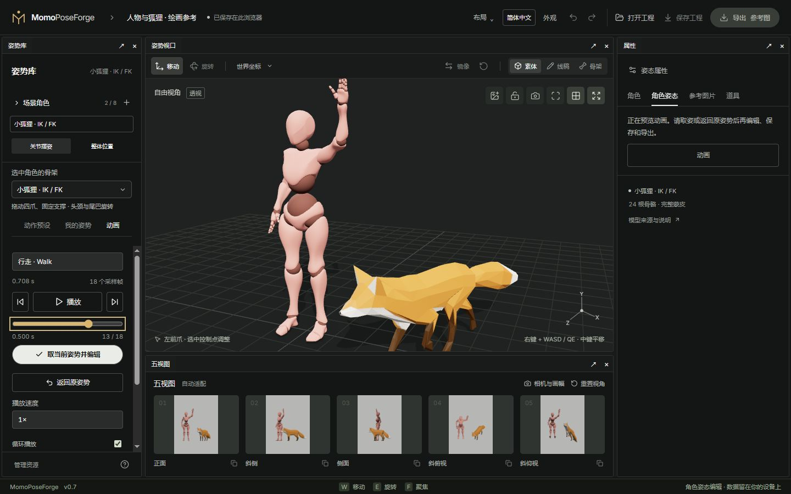

# 04 · 动画取姿与参考图

[简体中文](04-animation-and-reference.md) · [English](04-animation-and-reference.en.md)

[手册目录](README.md) · [多角色与资源](03-scene-and-assets.md)

## 动作从哪里来

- **Fox 内置动画**：观察、走路与奔跑（Survey / Walk / Run），随模型提供，可直接使用。
- **外部人体动画**：X Bot / Y Bot 支持兼容 Mixamo 层级的 FBX / GLB 动画文件。可使用自己制作或有权使用的文件；网站不会自动下载 Mixamo 内容。
- **BodyChan / BodyKun**：使用已有动作预设、手势和手动摆姿，目前没有外部人体动作迁移入口。

动画导入与**角色外观导入**是两件事：前者读取动作，后者更换表面和服装。不同骨架之间不做任意自动动作映射。

## 从动画捕获一个姿势

1. 选中角色，切到左侧**动画**。
2. 选择内置片段；支持外部动作的人体也可以导入 FBX / GLB。
3. 播放观察，暂停后拖动帧滑块，或用前/后一帧细选。
4. 点**取当前姿势并编辑**，将这一帧提交成静态可编辑姿势。
5. 切回控制点，继续 IK / FK 调整，再保存工程。

按钮文案会随语言变化，捕获入口位于播放与帧进度区域下方。选择**返回原姿势**会取消预览，恢复进入动画前的编辑姿势。只暂停不代表已经捕获；切换角色或骨架会结束未捕获的预览。

每个角色保留自己的动作资源与采样状态，但当前预览只控制选中角色。这里用于静态取姿，不是多角色时间轴或动画剪辑器。外部人体动作会适配到当前规范骨架并保留原骨长；源模型的所有变形效果不保证一致。**原地播放**用于控制根部位移。

## 用图片辅助对姿

在视口图片按钮或右侧**参考图片**中导入 ≤10 MB 的 PNG、JPEG、WebP。调整透明度、等比缩放和位置，再锁定参考层，以免摆姿时误拖图片。

图片是共享的二维参考层，不会自动识别人体或生成姿势。它会随工程保存，但不进入素体、线稿、骨架、深度、法线或遮罩图像。姿势撤销保留当前参考层。

## 用道具定位手脚

右侧**道具**可添加椅子、桌子、方块或握杆，最多 12 个。调好位置、尺寸与朝向后，选择道具接触点，再使用当前骨架提供的手脚定位入口。

接触成功后会固定末端；目标超出可达范围时保留原姿势并提示。固定位置属于世界坐标，道具移动后不会自动带着手脚走，需要解除固定并重新定位。这不是自动坐下、抓握或碰撞求解。可见道具参与共享场景的图像导出。

下一步：[相机、五视图与导出](05-camera-and-export.md)
