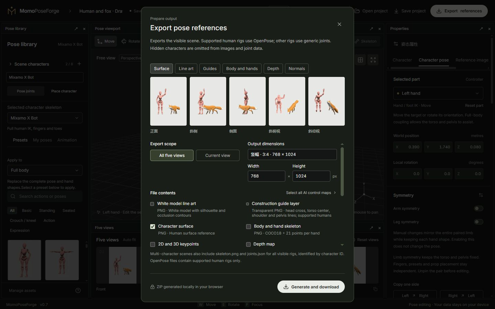
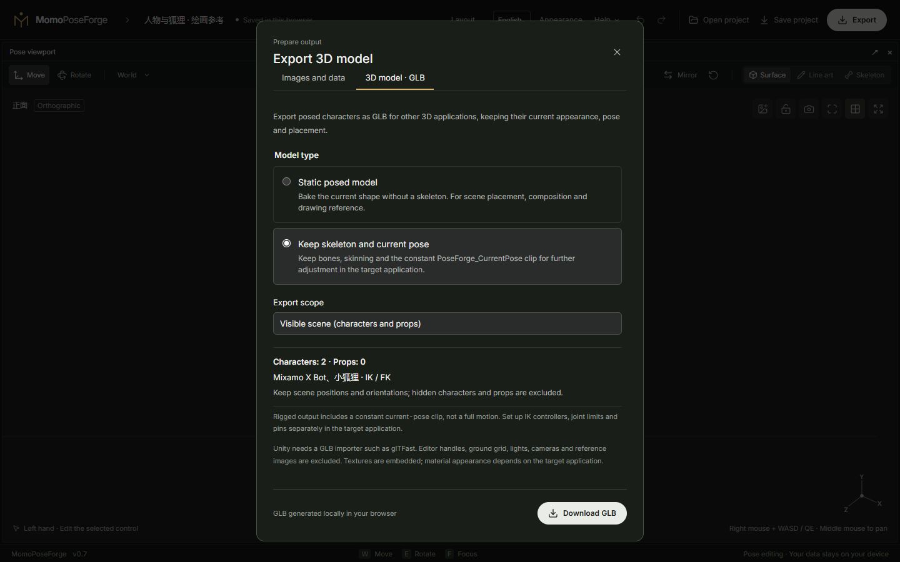

# 05 · Cameras, five views and export

[简体中文](05-camera-and-export.md) · [English](05-camera-and-export.en.md)

[Manual](README.en.md) · [Quick start](01-quick-start.en.md)

## Observation and output views

Free observation is for editing. The bottom five views update while posing, changing numeric controls, or playing animation, using the same visible scene. Each slot independently supports orthographic or perspective projection; old projects remain orthographic. Defaults are Front, Oblique, Side, Oblique high (+45°) and Oblique low (−30°). The last two are not vertical top/bottom views.

Use each preview’s projection selector and − / + zoom controls; click the percentage to reset zoom to 100%. The main viewport also has a projection switch at its top left. Click a preview to use that camera in the main viewport. On narrow screens, enable Show five views in the Layout menu if the panel is hidden; its previews scroll horizontally within the panel.

Open **Camera and frame** to change directions, names, projection, zoom and perspective field of view, or replace a slot with the current observation direction. Copying a direction preserves the slot’s projection and zoom. Choose Top (+90°) or Bottom (−90°) for true vertical views. There are still five output slots.

- **Observation camera lock** prevents accidental navigation.
- **Five-view framing lock** retains the shared center and scale. Refit explicitly when posing moves content out of frame.
- **Camera bookmarks** store complete observations, up to 12, without changing poses.
- **Output frame** supports 256–2048 pixels on each side, including square, landscape, portrait and custom proportions.

Automatic framing uses the union of visible actors and props. Hidden actors are omitted; locked actors remain included.

Live previews retain their framing during a drag instead of continuously fitting the moving pose. Automatic fitting still runs when an edit is committed. For stable framing across edits, use the framing lock next to the five-view heading and refit explicitly when needed. Previews and exports share camera parameters; perspective or differently zoomed slots do not claim a shared orthographic scale. These settings belong to the shared scene and survive project restoration and actor/rig switches.

## Surfaces, line art and construction guides

The viewport offers surface, line-art and skeleton display. Line art uses the actual mesh silhouette and edges, with 0.5–3 pixel line width, for all actors and props.

X Bot, Y Bot, BodyChan / BodyKun can display head crosses, torso centerlines, shoulder lines and pelvis guides. These follow posing and occlusion as drawing marks without changing body geometry. Fox has ordinary mesh outlines, not human construction guides.

Select the line-art export channel to produce `lineart.png`, optionally on a transparent background. The construction-guide channel creates transparent `construction-guides.png` for overlays. A viewport display mode does not automatically enable its export channel.

## Choose channels by purpose

| Purpose | Suggested output | Meaning |
| --- | --- | --- |
| Drawing and composition | Surface or line art, optionally guides | Shape, occlusion, perspective and body direction |
| Human pose conditioning | OpenPose image / JSON | Supported human bodies and hand keypoints only |
| Scene spatial conditioning | Depth | Distance along the camera direction |
| Surface orientation conditioning | Normals | Surface directions, distinct from depth |
| Foreground extraction/compositing | Mask | Visible character and prop foreground |
| Custom analysis/integration | Generic joints / skeleton image | Per-actor joints, hierarchy, world and projected positions |

Set views, dimensions, background and channels, wait for the preview, then download the ZIP. Depth or normal export automatically includes `mask.png`; there is no separate mask checkbox. More channels and larger sizes take longer to render and compress.

## Identify actors in exported files

Surfaces, line art, depth, normals and masks render the visible scene together, retaining actor/prop occlusion. Hidden actors are omitted from images and joints; locked actors are included.

Human OpenPose has separate `people[]` entries with `actor_id`. Fox, BodyChan and BodyKun are not encoded as COCO humans; use generic `joints.json` or scene joints. Multi-actor `skeleton.png` can show all visible rigs while OpenPose images retain human encoding.

The manifest records dimensions, views, channels and actors; asset notes retain credits. `project.scene.json` stores the scene, while legacy `project.pose.json` represents only the selected actor. Neither carries all source resources like a complete project bundle.

## Export to other 3D applications

Choose **Export → 3D model · GLB**, select the model type and scope, then **Download GLB**. Capture or cancel animation preview first.

- **Static posed model** bakes the current deformation into ordinary meshes without bones, for scene placement, composition and drawing reference.
- **Keep skeleton and current pose** retains bones, skinning and current local transforms. A constant `PoseForge_CurrentPose` clip lasts about 1/30 second. It stores one pose rather than a full motion; apply it if the receiving application resets the pose.
- **Visible scene** includes all visible characters and props. Locked actors remain included; hidden actors and props are excluded. Multiple instances of the same rig keep independent poses and resources.
- **Selected character** includes only the selected visible actor, without other actors or props, retaining its scene position and orientation.

Human, Fox and drawing rigs use the same export entry and their actual hierarchies. Fox is not converted into a human skeleton. The active appearance and textures are included; cached outfits are excluded. Appearance names and rig source information are retained in GLB metadata.

GLB uses metres and Y-up coordinates; the receiving application may convert axes/units. Textures are embedded, but materials, lighting and rendering depend on that application. Editor handles, skeleton guide lines, ground grid, lights, cameras and reference images are excluded. IK controllers, joint limits, pins and inter-character contacts are not converted into engine controls.

Unity requires a GLB importer such as [glTFast](https://github.com/Unity-Technologies/com.unity.cloud.gltfast/blob/main/Packages/com.unity.cloud.gltfast/Documentation~/ImportEditor.md) before placing the file in `Assets`. FBX export, full-motion export and automatic cross-rig retargeting are not included. GLB is for external 3D applications; keep a complete `.poseforge` project to continue editing in PoseForge.

## External AI workflows

The site supplies control images/data rather than generating AI images or models. The downstream model/workflow must support the selected channel, dimensions, keypoint encoding and normal convention. Files do not become conditioning inputs automatically.

AI export presets and local runner materials are available. Direct ComfyUI connection/workflow integration remains a planned feature; static export is not a live ComfyUI integration.

Next: [Workspace and saving](06-workspace-and-storage.en.md)
