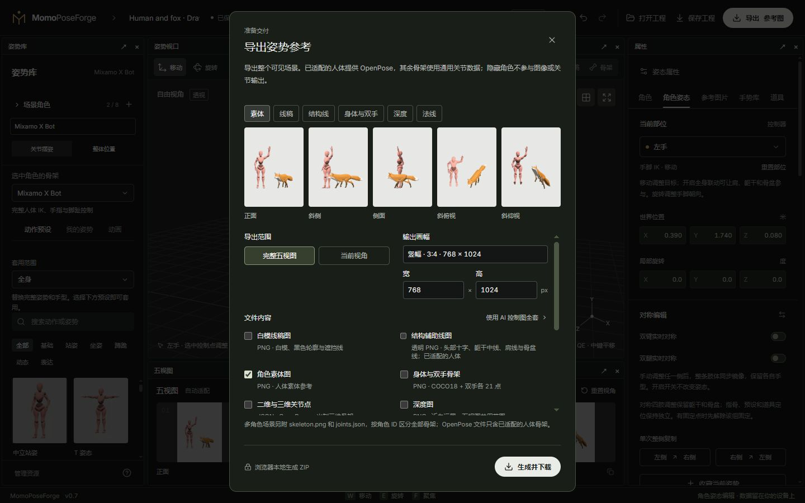
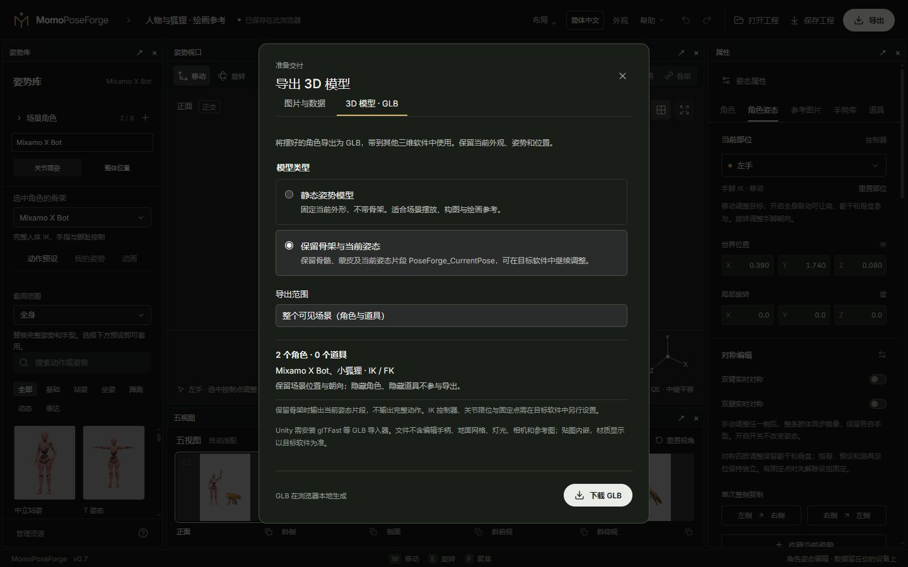

# 05 · 相机、五视图与导出

[简体中文](05-camera-and-export.md) · [English](05-camera-and-export.en.md)

[手册目录](README.md) · [快速上手](01-quick-start.md)

## 观察相机与五视图

自由观察用于摆姿检查；底部五视图在拖动关节、数值调整和动画播放时实时显示同一可见场景。每个槽位可独立选择正交或透视，旧工程默认正交。默认方向为正面、斜侧、侧面、斜俯视（上方 45°）、斜仰视（下方 30°）。后两者不是垂直顶视和底视。

小窗口下方可直接切换投影，用 − / + 调整独立缩放，点击百分比恢复 100%。主视口左上角也可直接切换正交／透视。点击小窗口可将该相机切到主视口继续编辑。窄屏若未显示此面板，可在布局菜单勾选“显示五视图”；小窗口可在面板内横向滚动。

打开**相机与画幅**，可修改方向、名称、投影、缩放及透视视野角，或用当前观察方向替换一个槽位；复制方向保留槽位自己的投影和缩放。需要真正上下视图时选择顶视（+90°）或底视（−90°）；仍会输出五幅图。

- **锁定观察相机**防止导航误动。
- **五视图构图锁**固定共用的构图中心和尺度。摆姿出框时可显式重新适配。
- **相机书签**保存完整观察，最多 12 个；恢复书签不改变角色姿势。
- **画幅**支持每边 256–2048 像素，可用正方形、横幅、竖幅或自定义比例。

多角色场景按可见角色和道具的联合范围适配。隐藏角色不影响输出，锁定角色仍包含在内。

实时小窗口在拖动期间保持已有取景，不逐帧重新居中或缩放；自动适配仍会在姿势提交后更新。需要连续摆姿保持完全相同构图时，使用五视图标题旁的构图锁；出框后可点重新适配。小窗口与导出共用相机参数，透视或不同缩放的五视图不再声明统一正交尺度。相机设置属于共享场景，保存和恢复工程、切换角色或骨架时保留。

## 素体、线稿与结构线

视口提供素体、线稿和骨架显示。白模线稿根据网格轮廓与边缘生成，线宽可调 0.5–3 像素，适用于全部角色和道具。

X Bot、Y Bot、BodyChan / BodyKun 可显示头部十字、躯干中线、肩线和骨盆结构辅助线。它们跟随姿势并遵守遮挡，是绘画标记，不改变身体外形。狐狸只有普通网格轮廓，没有人体结构辅助线。

导出时单独勾选**白模线稿图**生成 `lineart.png`，可使用透明背景；**结构辅助线图**生成透明 `construction-guides.png`，便于后期叠加。视口显示模式不意味着已勾选对应导出通道。

## 按用途选择导出通道

| 目标 | 建议输出 | 含义 |
| --- | --- | --- |
| 绘画临摹、构图参考 | 素体或线稿；需要时加结构线 | 检查外形、遮挡、透视和人体朝向 |
| 让 AI 参考人体动作 | 人体 OpenPose 图片 / JSON | 只包含支持 OpenPose 的人体及其双手关键点 |
| 让 AI 参考场景空间 | 深度图 | 表示相机方向的前后距离 |
| 让 AI 参考表面朝向 | 法线图 | 表示表面方向，和深度不是同一种信息 |
| 分离前景或后期合成 | mask | 可见角色与道具的前景遮罩 |
| 自行分析或开发接入 | 通用关节 JSON / 骨架图 | 各实例实际的关节、层级、世界及投影坐标 |

选择要导出的视角、像素宽高、背景及通道，等待预览后下载 ZIP。勾选深度或法线时会自动附带 `mask.png`，不需要寻找独立的遮罩勾选项。通道越多、尺寸越大，生成和压缩用时越长。

## 多角色文件怎么区分

素体、线稿、深度、法线与 mask 统一渲染整个可见场景，包含角色之间与道具的遮挡。隐藏的实例不参加图像与关节输出，锁定的实例仍参加。

人体 OpenPose 的 `people[]` 按人分开，并带 `actor_id`。Fox、BodyChan 和 BodyKun 不会伪装成 COCO 人体；用通用 `joints.json` 或场景关节数据读取它们。多角色的 `skeleton.png` 可显示全部可见骨架，OpenPose 图保持人体编码。

ZIP 的清单记录输出尺寸、视角、通道和实例信息；资源说明保留模型署名。`project.scene.json` 保存完整场景，兼容用的 `project.pose.json` 只表示选中角色。它们不是携带源资源的完整工程包。

## 导出到其他 3D 软件

右上角**导出 → 3D 模型 · GLB**，选择模型类型和范围，再点**下载 GLB**。先将动画预览取姿或取消，再进行导出。

- **静态姿势模型**：将当前蒙皮变形及外形烘焙到网格，不带骨架，适合场景摆放、构图和绘画参考。
- **保留骨架与当前姿态**：保留骨骼层级、蒙皮和当前局部变换，附带 `PoseForge_CurrentPose` 恒定姿态片段（约 1/30 秒）。这是当前姿势，不是完整动作；若目标软件重置了姿态，可应用这个片段。
- **整个可见场景**：包含所有可见角色和道具。锁定角色仍导出；隐藏角色和隐藏道具不导出。相同骨架的多个实例保留各自的姿势与资源。
- **选中角色**：仅导出选中的可见角色，不带其他角色或道具；保留其在场景中的位置与朝向。

人体、Fox 与绘画素体使用相同导出入口，按实际骨架层级输出，不把狐狸转成人体骨架。当前外观和贴图随文件导出，缓存的其他外观不导出；外观名称及骨架来源说明写入 GLB 元数据。

GLB 使用米制、Y 向上坐标；目标软件可能转换轴向和单位。贴图内嵌，但材质、灯光和渲染效果取决于目标软件。文件不含编辑器手柄、骨架辅助线、地面网格、灯光、相机或参考图片。IK 控制器、关节限位、固定点和角色间接触关系不转换成目标引擎的控制系统。

Unity 需安装 [glTFast](https://github.com/Unity-Technologies/com.unity.cloud.gltfast/blob/main/Packages/com.unity.cloud.gltfast/Documentation~/ImportEditor.md) 等 GLB 导入器，再将文件放入 `Assets`。目前不提供 FBX 导出、完整动作导出或跨骨架自动重定向。GLB 用于外部三维软件；在 PoseForge 继续编辑仍请保存完整 `.poseforge` 工程。

## 与其他 AI 工具配合

网站负责提供控制图与数据，不在这里生成 AI 图片或模型。下游需要与该通道兼容的模型/工作流，按它的要求选择尺寸、关键点编码和法线方向。深度、法线、骨架不会因为放进文件夹就自动生效。

已有 AI 控制图导出预设和附带的本地运行资料；ComfyUI 的直接连接与工作流集成仍作为待开发项，不把静态导出描述为已接入 ComfyUI。

下一步：[工作台与保存](06-workspace-and-storage.md)
