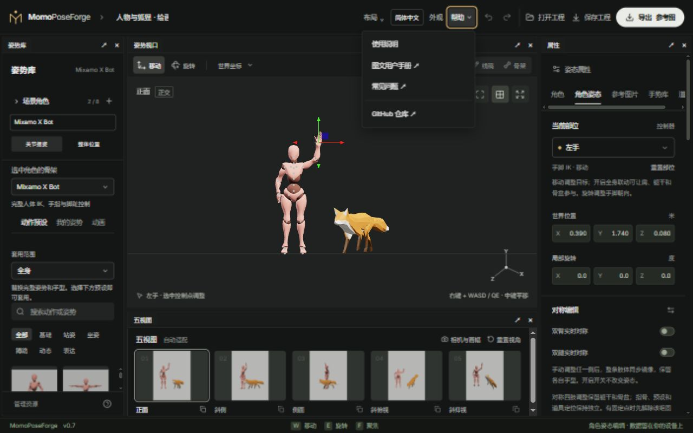

# 06 · 工作台与保存

[简体中文](06-workspace-and-storage.md) · [English](06-workspace-and-storage.en.md)

[手册目录](README.md) · [常见问题](faq.md)

## 调整面板布局

拖动面板标签，在停靠提示处松开，可拆分、合并为标签组或放到网页内悬浮窗口。面板分隔条用于调整宽高；关闭面板后可从顶部**布局**找回，也可选择预设或保存命名布局。

布局改变不会重建角色或清空姿势。小屏以标签切换为主，先打开要操作的姿势库或属性面板，再回到视口观察。面板缩窄时预设卡片列数会自动调整。

## 外观和语言

顶部**外观**提供主题、控件样式、页签和密度等当前工作台支持的设置。实时预览，保存后记住选择，取消恢复打开前的状态。它改变界面，不改变角色颜色、工程内容或图片输出。

顶部语言选择支持简体中文和 English。按钮、固定文案和帮助入口随语言变化，用户自己的角色名、工程名、收藏名不自动翻译。部分求解或文件校验错误仍可能显示中文。

布局、主题和语言属于当前站点的浏览器偏好，不写入姿势工程，也不参与姿势撤销。

## 帮助菜单

顶栏**帮助**与 TextureForge 一样使用下拉菜单：**使用说明**在当前页面打开快捷操作说明；**图文用户手册**与**常见问题**在新标签页打开对应语言的文档；**GitHub 仓库**进入项目主页。

点菜单外部、移出键盘焦点或按 Esc 可关闭菜单。键盘可用 Enter / 空格展开，再按 Tab 访问条目；Esc 会返回帮助按钮。使用说明会按当前选中骨架显示相应控制方式，不改变角色姿势或工程数据。

## 选择正确的保存方式

| 方式 | 保存什么 | 什么时候使用 |
| --- | --- | --- |
| 自动草稿 | 当前场景；资源仍存本机资源库 | 同一浏览器、同一地址刷新后继续 |
| 完整 `.poseforge` | 所有角色、共享场景、自定义外观源文件、勾选的外部动画 | 跨设备、分享或可靠备份 |
| 轻量 `.scene.json` | 完整场景结构与资源引用 | 目标浏览器已经有相同资源时 |
| 我的姿势 | 兼容角色的姿势与缩略图 | 快速复用到选中的角色，不替换整个场景 |
| 手势收藏 | 某只手的手型 | 复用手指姿态或单独导入/导出手势库 |
| 图像导出 ZIP | 参考图、控制数据、清单与场景 JSON | 绘画、合成或交给外部 AI 工作流 |

完整工程包最大 128 MiB，最多 24 个不同外部动画片段。重复使用的源资源在包内去重；内置模型由目标应用提供，所以接收方需要支持对应骨架版本。旧单角色 `.pose.json` 和 v1 工程包可以打开并升级为单角色场景。

图像 ZIP 和轻量 JSON 不代替资源完整备份。换电脑前下载 `.poseforge`，并在目标设备实际打开确认。

## 跨设备继续编辑

1. 在**保存工程**中选择完整包，勾选想携带的外部动画；默认选择各角色当前片段。
2. 将下载文件传到另一台设备。
3. 在新设备访问编辑器，点**打开工程**选择文件。
4. 确认角色、外观、静态姿势及动作书签恢复后，再开始新操作。

打开工程时先校验数据和资源，失败会保留当前场景。打开后保持静态编辑，不会自动同时播放所有角色。当前会话的撤销栈和各候选骨架缓存不随工程转移。

## 本地存储与恢复

浏览器存储按来源地址隔离：`localhost` 与 `127.0.0.1`、不同端口、在线站点和不同浏览器不自动共享。隐私模式、存储权限、浏览器空间清理会影响持久保存。

清理站点数据可能删除草稿、收藏、资源和偏好。它们没有服务器副本。遇到空间不足先下载完整工程，不要只依赖“已保存在浏览器”的提示。

本地草稿缺少可选外观时，会提示并使用原始表面恢复姿势；其他草稿恢复错误会保留原草稿，避免被空场景覆盖。主动打开工程文件仍严格校验必需资源。
