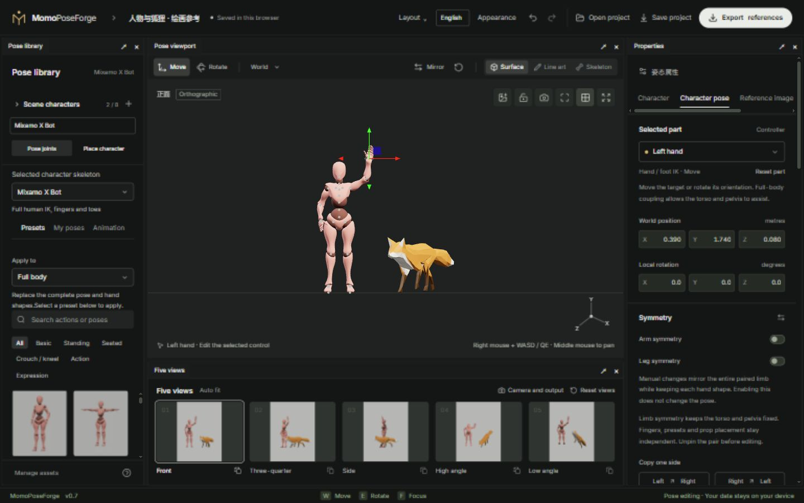

# Illustrated user manual

[简体中文](README.md) · [English](README.en.md)

[Project home](../README.en.md) · [Open editor](https://breezymomo.github.io/MomoPoseForge/)

Start from a preset, then look up the task you need. Screenshots use a separate demo scene. Window size, saved layout, selected character and theme may differ from your workspace.

## Start here

1. [Quick start](01-quick-start.en.md): choose a character, pose it, save and export.
2. [Rigs and posing](02-posing-and-rigs.en.md): supported controls, IK, FK and pins.
3. [Characters and appearances](03-scene-and-assets.en.md): actor instances, rig switching, skins and local resources.
4. [Animation and references](04-animation-and-reference.en.md): capture a frame, use an image or position a prop.
5. [Cameras, five views and export](05-camera-and-export.en.md): frame the scene and choose drawing or AI channels.
6. [Workspace and saving](06-workspace-and-storage.en.md): layouts, themes, language, local storage and portable backups.

See [FAQ](faq.en.md) for problems, or [Development](development.en.md) for local setup and deployment.

## Three concepts

- A **rig** defines anatomy, editable joints, constraints and export capabilities. Rig switching changes the selected actor's body structure.
- An **actor instance** is one person or animal in the scene. Multiple actors may use the same rig while keeping independent poses, appearances and pins.
- The **shared scene** owns cameras, lighting, ground, five views, reference image and props. Selecting another actor does not rebuild the others.

An **appearance** is a complete character surface and clothing compatible with a rig. Replacing it retains the control rig; changing the rig is a separate operation.

## Where work is stored

Automatic drafts and resources belong to this browser and site address. They are not cross-device backups. Save a complete `.poseforge` before moving to another device. The editor has no account-based cloud sync or built-in AI model generation.
