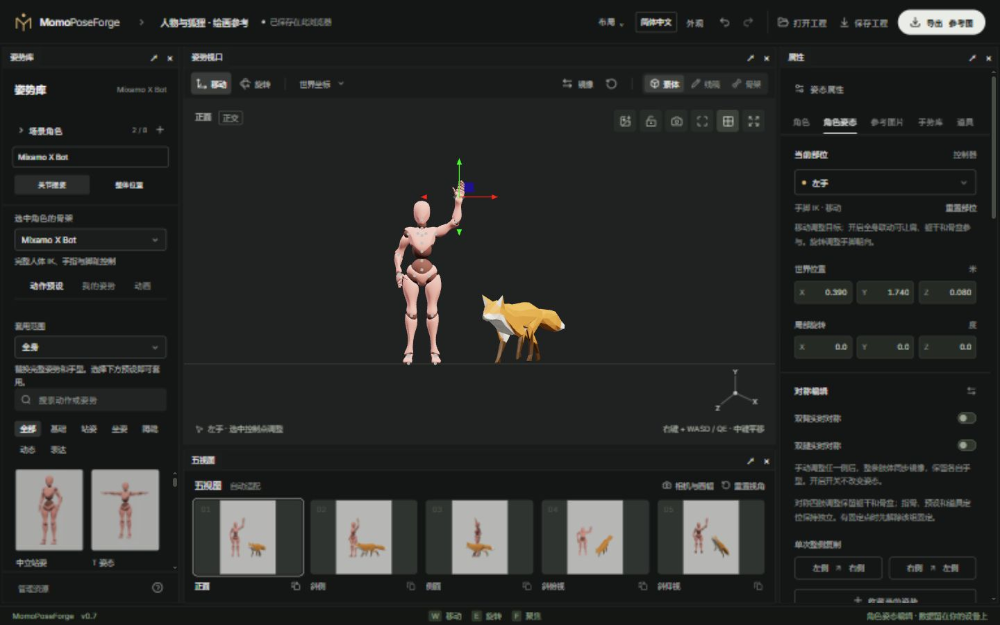

# 图文用户手册

[简体中文](README.md) · [English](README.en.md)

[项目首页](../README.md) · [打开在线编辑器](https://breezymomo.github.io/MomoPoseForge/)

先用动作预设摆出第一个姿势，再按任务查找需要的操作。截图来自独立演示场景；窗口大小、保存的布局、角色和界面主题可能与你的页面不同。

## 从这里开始

1. [快速上手](01-quick-start.md)：选择角色、调整姿势、保存工程、导出参考。
2. [骨架与摆姿](02-posing-and-rigs.md)：了解不同角色能控制什么，怎样用 IK、FK 和固定点。
3. [多角色与外观资源](03-scene-and-assets.md)：管理多个实例、切换骨架、换装和导入资源。
4. [动画取姿与参考图](04-animation-and-reference.md)：从动作里选一帧，结合图片和道具继续调整。
5. [相机、五视图与导出](05-camera-and-export.md)：设置观察与输出，选择绘画或 AI 所需通道。
6. [工作台与保存](06-workspace-and-storage.md)：调整布局、主题和语言，了解数据与跨设备备份。

遇到问题先看[常见问题](faq.md)。本地启动、依赖排错与发布方法在[开发与部署](development.md)。

## 三个概念

- **骨架**决定身体结构、可编辑关节、约束和导出能力。换骨架会更换选中实例的身体结构。
- **角色实例**是场景中的一个人或动物。多个实例可以使用同一种骨架，各自保存姿势、外观和固定点。
- **共享场景**包含相机、灯光、地面、五视图、参考图片与道具。换选中角色不会重建其他角色。

**外观**是兼容骨架上的完整角色表面和服装。换外观沿用骨架；给模型换一种骨架则是另一种操作。

## 数据留在哪里

自动草稿与资源库只属于当前浏览器和访问地址，不等于跨设备备份。准备关闭或换电脑时，保存完整 `.poseforge` 工程。工具不提供账号云同步，也不在网站中调用 AI 生成模型。
