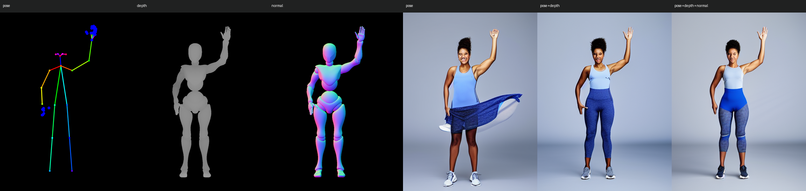
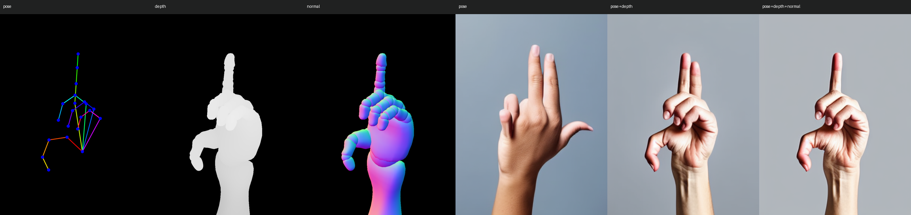

# AI 控制图导出与工作流验收

v0.2 完成三部分：身体与双手数据、深度与法线图，以及一个可实际运行的本地 ControlNet 工作流。网站端只负责摆姿和导出，不需要账号、模型权重或推理服务。

## 在网站中使用

打开“导出参考图”，通过上方标签预览素体、身体与双手骨架、深度和法线。选择“使用 AI 控制图全套”，再按需要勾选素体及拼图，下载 ZIP。预览标签与下载勾选项相互独立；当前视角使用实际观察相机，五视图使用统一构图和深度范围。

“隐藏被遮挡的手部点”默认开启。身体点继续保留有效遮挡关节；手部按实际可见表面判断，腕、指根、其他指节的深度容差分别为 35、18、9 毫米，以容纳骨骼中心位于自身蒙皮内部的情况。近景手势可关闭过滤来输出已知的完整骨架，避免自遮挡使部分线段中断。画面外和无效点仍为 [0,0,0]。c=1 是合成有效标记，不是检测模型的置信度。

## 文件约定

每个视角的目录中包含所选内容：

- `mannequin.png`：素体参考图，可单独选透明背景。
- `openpose-body-hands.png`：COCO18 身体和双手各 21 点，黑底。手部连接及 HSV 线色参考 ControlNet 的 OpenPose 绘制约定。
- `keypoints-openpose.json`：OpenPose 1.3 字段、像素坐标，身体 54 个数，每手 63 个数。手部顺序为腕，随后拇指、食指、中指、无名指、小指各四点。
- `openpose-coco18.png`、`keypoints-coco18.json`：旧身体 18 点兼容文件，不含手部。
- `depth.png`：相机轴向深度，近白远黑，8 位线性数值，五视图共用归一化范围。不是透视相机的非线性硬件 Z 缓冲截图。
- `normal.png`：相机空间表面法线。相机 X 朝右、Y 朝上、Z 朝向观察者；RGB = 0.5 × (-Nx, Ny, Nz) + 0.5，即正面偏蓝、左面偏红、上面偏绿。
- `mask.png`：白色角色、黑色背景；选择深度或法线时自动包含。

公共文件有 `manifest.json`、可选 `project.pose.json`、`skeleton-world.json` 和拼图。三维骨架以米为单位、世界坐标 Y 向上、初始 +Z 向前，包含身体和完整双手，不受二维遮挡过滤。它不是 OpenPose 多相机三角测量的输出。2D JSON 的官方 3D 字段保持空数组，避免混淆坐标语义。尚无完整面部点集。

数据 PNG 的原始通道值不经过灯光、色调映射或 sRGB 数值转换。黑色背景不能解码成有效深度/法线，须结合 mask。PNG 的量化误差和深度米制范围见 manifest；它们是生成控制图，不是高精度测量数据。

## 本地运行

控制图 ZIP 附带 `tools/run-controlnet.py`、`tools/requirements-controlnet.txt`、`workflows/controlnet-models.json` 和 `workflow-controlnet.json`。把 ZIP 解压到一个新目录，在该目录创建 Python 虚拟环境并激活，先按 [PyTorch 官方安装说明](https://pytorch.org/get-started/locally/)安装适配显卡的 CUDA PyTorch，再执行：

```powershell
python -m pip install -r tools/requirements-controlnet.txt
python tools/run-controlnet.py "原始导出包.zip" --view front --out results --ablation
```

`--view` 必须是 ZIP 中的视角 ID，手部近景使用 `current`。首次运行下载约 5 GB 的公开模型，之后可添加 `--offline` 并用 `--model-cache` 指向已有缓存。脚本使用 safetensors；不执行模型仓库中的远程 Python 代码。模型版本固定在清单中，模型权重和 Python 测试环境不会打包进网站。

省略 `--ablation` 时按所选通道运行一次。三通道齐全时，`--ablation` 比较骨架、骨架+深度、骨架+深度+法线。可通过 `--prompt` 修改人物、服装描述，`--seed` 和 `--steps` 修改复现实验参数。手部精调的当前视角导出会使用手部提示词，指向/握拳/张手预设会传递对应描述。直接使用导出的控制图，不要再次运行 DWPose、深度估计或 Normal BAE 预处理。

本轮已测 Python 3.11、PyTorch 2.5.1+cu121、Diffusers 0.35.2、Transformers 4.44.2、RTX 4070。此脚本需要 CUDA，不会将缺少运行环境的情况报告为已经生成成功。依赖版本、模型修订与提示词保存在配置/报告中，跨硬件不承诺逐字节一致。

## v0.3 画幅支持

相机面板和导出面板共用工程里的输出宽高，范围均为 256–2048 整数像素，提供竖幅、方形、横幅和宽屏预设。所有 PNG、二维关键点和拼图单元按实际宽高生成；五视图可锁定统一中心与尺度，锁定状态记录在 manifest 的 viewFit.locked。

便携工作流不再只接受 3:4：生成尺寸最长边为 512、短边按比例取最近的 8 像素倍数。非整比尺寸按同一规则对全部控制图等比缩放并补黑边，不拉伸；原 768×1024 输入仍对应 384×512。

本轮已实际运行一个 1000×777 当前透视视角的三通道导出，使用 ZIP 内解压出的脚本、离线固定模型缓存和默认 24 步，输出 512×400，耗时 6.83 秒。该记录验证新画幅可运行，不承诺与素体完全一致的生成效果。复现材料：[输入包](validation/camera-custom-export.zip)、[生成报告](validation/camera-custom-generation.json)、[控制图与结果](validation/camera-custom-comparison.png)。

## 实际生成记录

保留的默认对照为全身挥手和手部指向，每组固定种子 20261029、24 步、UniPC、CFG 7、384×512。骨架、深度、法线权重分别为 0.9、0.5、0.3。每组使用相同提示词和初始随机种子，不筛选多个种子来替换失败图。

从左至右，图中依次是三张输入控制图，以及骨架、骨架+深度、骨架+深度+法线的生成结果。





这两组中，深度明显约束了轮廓与体积。手部默认提示词下，骨架和骨架+深度结果仍多伸出一根手指，三通道结果更接近单指指向。额外使用更明确提示词的试验中，深度也能得到单指结果，因此不能把这一次比较推广成“必须加法线”或保证正确手指。手掌解剖、拇指长度等细节仍有瑕疵，X Bot 分段几何也可能影响生成。

三种配置每次实测约 4.7–6.1 秒，峰值 CUDA 已分配显存约 3161、3858、4561 MiB，不含模型首次下载。解压后的便携脚本另作一次三通道运行，耗时 6.6 秒，PNG 哈希与仓库脚本同配置结果相同。这是本机固定案例的生成兼容性验证，不是所有模型、手势或分辨率的效果保证；独立生成多个视角也不会自动保持角色身份一致。

证据与复现输入：

- [全身输入 ZIP（含便携脚本）](validation/fullbody-export.zip)、[手部输入 ZIP](validation/hand-export.zip)。手部样例可用同一份脚本运行。
- [全身生成报告](validation/fullbody-generation.json)、[手部生成报告](validation/hand-generation.json)、[独立目录运行报告](validation/portable-generation.json)。报告保留原始实验 ZIP 名称和哈希；完整交付包后补的脚本不改变控制图输入，三个控制图哈希已核对一致。
- [五视图几何复核](validation/fullbody-maps.json)、[手部遮挡复核](validation/hand-visible-maps.json)、[手部完整骨架复核](validation/hand-all-maps.json)。

## 几何与文件验收

```powershell
npm test
python -m unittest discover -s tools -p "test_controlnet_export.py"
node web/scripts/verify-export.mjs "导出包.zip"
node web/scripts/verify-control-maps.mjs "导出包.zip" "校验结果.json"
```

119 项前端测试、8 项 Python 文件契约测试通过。独立脚本从实际 GLB 重建姿态，对变形三角面射线取样，并用 GPU 相同的蒙皮顶点法线进行 CPU 插值。五个正交视角抽样 439 点，透视近景另外抽样 156 点；深度/法线最大误差均低于一个字节，手部关键点最大投影误差低于 0.000500 像素，三维点误差为 0，遮挡不一致数为 0。

浏览器还检查了预览通道、当前视角、遮挡开关、1536×2048 导出取消和视口恢复；桌面、平板和手机的下载操作保持可见，页面无横向溢出。现有小字号和较长属性面板仍保留两项界面警告。

参考：[OpenPose 输出格式](https://github.com/CMU-Perceptual-Computing-Lab/openpose/blob/master/doc/02_output.md)、[ControlNet 手部绘制](https://github.com/lllyasviel/ControlNet-v1-1-nightly/blob/main/annotator/openpose/util.py)、[ControlNet 1.1 深度/法线约定](https://github.com/lllyasviel/ControlNet-v1-1-nightly)、[Diffusers ControlNet](https://huggingface.co/docs/diffusers/using-diffusers/controlnet)。
