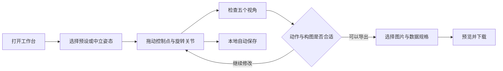

# MomoPoseForge 首版产品设计文档

评审草案 v0.1 · 2026 年 10 月 29 日

MomoPoseForge 是面向 AI 创作者的在线人体姿势编辑工具。用户从预设或中立姿态开始，通过拖动身体控制点调整姿势，再从同一份三维姿态输出五视图、骨架控制图和可恢复编辑的姿态文件。

首版只支持人类。采用 Three.js 在浏览器中完成编辑和渲染，人体采用用户指定的 Mixamo X Bot 分段人偶，以 GLB 随站点提供；不接入 AI 生成或识别模型。动物作为后续扩展，首版不展示动物入口。

本稿用于评审产品范围与交互行为，尚未实现网站。用户已明确的方向是人体、在线调姿势、完整 IK、预设、五视图及图片与数据导出；文中具体角度、预设数量、手部粒度和导出规格为本稿提出的首版方案。

# 1 产品目标与使用人群

主要用户是需要控制人物动作的 AI 绘图创作者，其次是需要多角度姿势参考的插画师和分镜创作者。用户通常已经知道想表达什么动作，但不熟悉三维软件，也难以在图片图库中找到恰好符合要求的参考。

首版要让用户完成三件事：

- 从接近目标的预设开始，用少量操作改成自己的姿势。
- 从不同方向检查动作，输出姿态一致、构图稳定的五张参考图。
- 把图片或关节点文件交给后续工作流，并保留以后继续编辑的源文件。

核心体验是“拖住手脚就能摆动作，细节可以继续精调”。默认直接进入工作台，打开即可操作，无需注册或创建云端项目。

# 2 首版范围

## 必须完成

- 单个人体蒙皮素体，具备可辨认的头部朝向、躯干、四肢、手掌与脚掌。
- 身体 IK 与关节旋转编辑，包含四肢末端控制、肘膝朝向、骨盆与胸腔控制、手脚固定。
- 预设选择、整姿镜像、单侧姿势复制、局部与全身重置、撤销与重做。
- 自由观察，以及五个命名相机视角的预览与批量导出。
- 素体 PNG、身体骨架 PNG、二维关节点 JSON、工程 JSON 和 ZIP 打包。
- 本地自动保存、工程文件导入与导出。
- 中文桌面工作台，鼠标操作优先。

## 后续扩展

动物、自定义三维资产导入、多人互动、道具接触、动画时间轴、视频导出、AI 文字生成动作、图片识别姿势、云端账号与分享社区均不进入首版。

深度图、法线图、轮廓线稿、BVH 与 GLB 导出放到后续版本。它们不阻塞首版的“摆姿势并交付参考图”流程。

## 手部粒度的建议

首版提供张手、握拳、指向三种简化手型，并支持手腕方向调整。逐指关节编辑、手指 IK、面部表情和面部关键点导出后置。这是本稿建议的范围取舍，需在评审中确认。

# 3 典型任务与成功标准

## 任务一 调整站姿并用于 AI 绘图

用户选择“单手叉腰”，把另一只手抬高，转动头部，打开骨架模式，导出当前视角的骨架 PNG。整个过程无需理解骨骼树或输入三维坐标。

## 任务二 为同一动作制作五视图

用户选择“下蹲”，固定双脚，下移骨盆并改变胸腔前倾角度。用户逐个检查五个视角，导出五张素体图、一张拼图及各视角对应的关节点文件。

## 任务三 保存并继续创作

用户保存工程 JSON，关闭网页后重新导入。身体姿势、手型、固定点和五个相机均恢复，用户可以在此基础上继续修改。

## 可用性目标

在预设已加载的条件下，首次使用者能够在五分钟内完成“选预设、修改至少三个控制点、导出一组五视图”。这是待验证的设计目标。首轮用五名目标用户观察完成率、误操作和卡住的位置，不以按钮数量代替任务是否完成。

# 4 页面结构与工作台布局

站点以一个工作台承载主要任务，避免在图库与编辑器之间频繁跳转。预设库、快捷帮助和导出面板在工作台内打开。

- 顶栏：项目名、本地保存状态、撤销、重做、打开工程、保存工程、导出。
- 左栏：预设与“我的姿势”，可搜索和按动作类别筛选。
- 中央主区：三维视口、控制点、地面、方向指示和简短操作提示。
- 视口工具条：选择、拖动、旋转、世界或局部坐标、镜像、重置，以及素体或骨架显示。
- 右栏：当前部位名称、位置或角度、IK 固定、肘膝朝向、手型等上下文属性。
- 底部：五个命名视角缩略图。点击切换主视口，不改变人物姿势。

建议桌面宽度 1280 像素起提供完整三栏布局：左栏约 240 像素，右栏约 280 像素，剩余空间优先给视口。宽度不足时折叠两侧面板；手机端首版支持查看和下载已保存工程的视图，不承诺完整触控调姿体验。

视觉采用低干扰的深色工具界面，X Bot 保留红色外壳与深色关节，地面网格保持克制。控制点选中与固定状态除颜色外，还用实心、空心、锁定标记区分。导出图默认使用浅色背景，与工作台主题独立。

# 5 核心操作流程



首次打开直接显示中立站姿与四个手脚控制点，并用三条短提示解释拖动、转动视角和导出。进入“更多控制点”后显示肘膝、骨盆、胸腔和头部控制，降低初次面对的复杂度。

打开已有自动保存内容时优先恢复草稿，界面明确显示“已恢复本地草稿”，同时提供“新建姿势”。加载预设、导入文件和新建姿势都会成为可撤销操作。

# 6 人体素体与姿态表达

人体使用 Adobe Mixamo 的 X Bot 网格与蒙皮，保留红色外壳、深色关节和分段结构。模型整理成米制 GLB，Three.js 负责显示；IK 对照该模型的实际肘膝铰链轴求解，固定点和关节限位由网页姿态系统控制。

首版固定 X Bot 的一套人体比例。镜头缩放只改变观察，不改变身高；不开放拉长单根骨骼的操作，防止编辑过程中意外改变人体比例。可调身材比例在后续单独设计，避免与姿态编辑混在同一组控件。

姿态以关节局部旋转和根部变换为主数据；几何体、骨架图、五视图和投影关节点均由它计算。显示用的几何体不是唯一数据源，导出时不得反过来从屏幕截图估算骨架。

# 7 身体 IK 的范围与约束

IK 即拖动末端目标，让关联关节自动调整；FK 即直接旋转某个关节。两种方式共同构成首版的身体编辑能力。

## 手臂与腿部

左右手腕、左右脚踝分别具有可拖动的目标和可旋转的末端方向。拖动手腕时肩部与手肘联动；拖动脚踝时髋部与膝盖联动。每条链提供肘或膝的朝向控制，避免关节突然翻面。

在默认限位下肘膝不反折，骨段不伸长。目标超出可达范围时，末端停在最近的可达位置，并显示目标无法完全到达。界面要同时看得见目标和实际位置，不能让用户误以为拖动没有响应。

## 骨盆与胸腔

骨盆支持整体位置与方向调整；胸腔支持上身目标与方向调整，通过脊柱链分配动作。整体移动人物和局部移动骨盆是两个独立操作。

移动骨盆时重新求解启用固定的手脚链。头部朝向、锁骨、手腕与脚掌可通过旋转精调。切换 IK 与 FK 时先同步控制目标到当前姿态，人物不得突然跳动。

## 固定与地面接触

用户可固定任一手脚的位置，或同时固定位置与方向。固定点位于世界空间，移动骨盆时尽量保持；整个人物移动命令会连同固定目标一起移动。

地面吸附是可开关的辅助功能，处理脚掌接触高度。抬脚、腾空和躺姿时允许关闭。首版不包含全身碰撞、自动重心平衡或物理仿真。

多点约束互相冲突时按“保持骨长与关节限位、满足固定点、接近当前拖动目标”的顺序求解；不能全部满足时保留最近可行姿态，标记未满足的固定点并支持撤销。固定不代表在不可能的姿态下强行锁死。

## 精调与对称

右栏只展示当前选中部位的有效参数。肘膝显示朝向与弯曲，手腕显示末端旋转，骨盆显示位置和旋转。角度以度显示，内部使用四元数。

整姿镜像沿人体局部对称面计算，交换左右肢体与对应固定点；单侧复制只替换目标侧。相机不参与镜像。首版不使用单纯复制欧拉角的方式实现对称。

# 8 输入规则与编辑反馈

- 空白处拖动旋转视角；中键或 Shift 加拖动平移；滚轮缩放。
- 点击控制点选中部位；拖动控制点只编辑姿势，此时暂停相机旋转。
- 默认在与观察方向平行的操作平面内拖动；可切换轴向或平面约束，侧视图也能直接调整深度。
- W 切换拖动，E 切换旋转，F 聚焦人物，Esc 取消本次拖动并回到拖动前。
- Ctrl 或 Cmd 加 Z 撤销；Ctrl 或 Cmd 加 Shift 加 Z 重做。输入框有焦点时保留正常文字编辑行为。
- 控制点被素体遮挡时可开启透视控制点显示；导出始终隐藏控制点、选择轮廓、坐标轴和网格。

一次连续拖动只记录一条历史；加载预设、镜像、数值修改和重置分别形成独立历史步骤。切换观察视角不污染姿势的撤销历史。

出现限制时把提示放在相关部位附近，例如“右手已达到最大距离”或“左脚固定点无法同时满足”。不以弹窗打断每一次拖动。

# 9 预设与我的姿势

首版建议提供 18 个可编辑预设，按六类组织，每类三个：

- 基础：中立站姿、T 姿态、A 姿态。
- 站姿：重心偏移、单手叉腰、抱臂。
- 坐姿：正坐、前倾坐、盘腿坐。
- 蹲跪：深蹲、单膝跪、双膝跪。
- 动态：行走定格、跑步定格、弓步。
- 表达：挥手、双手上举、侧身回头。

坐姿预设不依赖椅子资产，可显示坐面高度辅助线，辅助线不导出。动态预设也是静态姿势，不包含动画播放。

预设保存为关节与控制器状态，载入后立即可编辑。缩略图由对应真实姿态生成。用户可给当前姿势命名并保存到“我的姿势”，内容仅保存在本浏览器，同时提供工程文件下载。

# 10 五视图与相机规则

首版建议默认沿用参考图库的创作视角：正面、斜侧、侧面、俯视和仰视。这是五个固定命名的创作视角；需要前后左右等方向时，用户可以替换相机。

约定初始人物面向世界 +Z，+Y 向上。方位角 0 度表示相机位于人物前方 +Z，正值向 +X 方向移动；仰角正值表示相机高于观察中心。

- 正面：方位角 0 度，仰角 0 度。
- 斜侧：方位角 45 度，仰角 0 度。
- 侧面：方位角 90 度，仰角 0 度。
- 俯视：方位角 0 度，仰角 45 度。
- 仰视：方位角 0 度，仰角 −30 度。

每个槽位可“用当前视角替换”和“恢复默认”，并支持重命名。人物转身后相机保持位置，避免相机跟随身体而看不出转身效果。

主视口默认透视观察；五视图导出默认使用正交投影，减少透视缩短对姿态比较的影响。Three.js 的正交相机不会因为物体与相机的距离变化而改变其成像尺寸。[正交相机文档](https://threejs.org/docs/pages/OrthographicCamera.html)

同一批导出共用观察中心、画幅和世界单位对应的像素比例。自动构图用五个相机投影的并集确定统一取景范围，四周至少保留约 8% 留白，不逐张独立放大。用户可锁定构图；锁定后如果动作越出画框，预览显示裁切提示。

五个底部缩略图在拖动结束后同步更新；导出必须读取点击导出时的最新姿态快照。自由观察不会自动覆盖已保存的五个相机。

# 11 图片与数据导出

## 导出入口

点击“导出”打开带预览的面板，依次选择当前视角或五视图、输出内容、分辨率和背景。普通使用者默认勾选素体图、五视图拼图和工程文件；骨架与关节点输出可一键切换到“AI 姿势控制”方案。

首版提供每张图 768 × 1024 和 1536 × 2048 两档规格。默认五张 PNG 独立输出，可附加一张 3 列 2 行拼图；第六格用于姿势名称和视角图例。拼图仅作参考展示，送入单视角工作流时使用对应的独立图片。

## 图片类型

- 素体图：Mixamo X Bot 素体，背景默认浅灰，可选择透明；地面阴影单独开关。
- 身体骨架图：按选定 COCO18 映射绘制的关节点与连线，黑底、不透明，不叠加地面、阴影或编辑控件。配色、连接关系和线宽作为固定导出配置维护。

首版骨架输出仅含身体及头部方向所需的 COCO18 点位，不含手部 21 点或完整面部点集。头部眼、耳、鼻等参考点由头部局部锚点计算。

## 两类 JSON

工程 JSON 用来恢复编辑，包含版本、骨骼定义标识、根部变换、关节旋转、IK 目标、固定状态、手型、相机和导出设置。

二维关节点 JSON 每个视角单独生成，采用 OpenPose COCO18 点序与 x、y、c 三元组。原点位于图像左上，x 向右、y 向下，坐标单位为最终输出像素；不混用编辑视口尺寸或归一化坐标。OpenPose 输出文档定义了点序与三元组格式，身体模型之间不能只换名称而复用点序。[OpenPose 输出格式](https://github.com/CMU-Perceptual-Computing-Lab/openpose/blob/master/doc/02_output.md)

这些点来自三维投影。有效点的 c 设为 1，只表示程序生成的有效点，不是图像检测置信度；缺失、超出画幅或位于相机背后的点写为零。首版默认保留被身体遮挡的有效点，按完整骨架方式绘图，并在 manifest 中记录这一策略。

项目自身的三维姿态与逐视角 JSON 分开存放，不把三维工程文件命名为 OpenPose 检测结果。

# 12 导出包与兼容性验收

ZIP 内采用稳定文件结构：

```text
pose-name/
  project.pose.json
  manifest.json
  README.txt
  contact-sheet.png
  front/
    mannequin.png
    openpose-coco18.png
    keypoints-coco18.json
  oblique/
  side/
  high/
  low/
```

后四个视角目录与 front 使用相同结构。未勾选的输出不生成。

manifest 记录应用版本、工程版本、坐标约定、相机投影类型与矩阵、图像尺寸、骨架映射版本、渲染配置及遮挡策略。每个视角的图片与关节点必须由同一相机和同一姿态快照生成。

README 用简短中文解释哪个文件适合直接作为图片参考，哪个文件用于支持 COCO18 的工具，以及怎样恢复工程。不给任意 JSON 文件作通用 AI 兼容承诺。

发布前至少记录并验证一个明确版本的下游姿势控制工作流：能读取输出的骨架图，能够得到方向和左右肢体正确的姿势条件。若某工具另有 JSON 外层结构，单独提供命名清楚的适配器并验收，不默认宣称所有工具都能导入。

# 13 本地保存与异常状态

用户停止编辑约一秒后自动保存当前草稿到本地存储，状态依次显示“保存中”“已保存在此浏览器”或“本地保存失败”。本地自动保存不能替代工程文件下载，清除浏览器数据会移除这些草稿。

导入工程先验证文件结构、版本与数值，再替换当前工程。无效文件保持原工程不变并说明原因；较新且不兼容的工程版本显示可理解的版本提示。升级旧工程时保留原文件，转换只发生在内存中。

导出期间冻结一份姿态快照，显示按视角完成的进度。取消或失败后保留编辑内容；不得把缺图的压缩包作为成功结果下载。显存或画布尺寸不足时建议改用低分辨率，仍由用户重新发起导出。

不支持所需图形能力时给出明确的浏览器提示。图形上下文丢失时尝试从已保存姿态重建视口，失败时仍保留工程下载入口。

# 14 技术方案与模块边界

本稿建议使用 TypeScript、React 与 Three.js 构建静态前端，首版无需服务器执行姿态计算或渲染。Three.js 负责场景、相机、拾取、控制器显示与出图；应用负责人体约束、编辑命令和文件格式。

- 人体定义：维护关节层级、静止姿态、局部轴、骨长、限位、几何体参数与关键点映射。
- 姿态求解：手脚使用双骨 IK 与肘膝方向约束，脊柱目标用受约束的多关节求解；统一协调固定点与骨盆变换。
- 编辑状态：集中管理姿态、控制目标、选择状态与命令历史；不让 React 界面对象成为关节数据源。
- 渲染层：素体、辅助控件和骨架控制图分层，批量导出使用独立相机及渲染目标。
- 相机管理：保存五个槽位与统一构图规则，提供预览和批处理。
- 文件层：统一处理版本迁移、工程 JSON、COCO18 映射和 ZIP。

Three.js 的 TransformControls 可以提供三维移动与旋转操纵器，但人体约束与固定点交互仍需产品自己的逻辑。[TransformControls 文档](https://threejs.org/docs/pages/TransformControls)

Three.js 还提供 CCDIKSolver，但其接口面向 SkinnedMesh；本产品采用真实 SkinnedMesh，但仍使用独立于渲染对象的姿态求解层，不把该插件视为现成的完整人体 IK 系统。[CCDIKSolver 文档](https://threejs.org/docs/pages/CCDIKSolver.html)

以后接入动物时新增对应的骨骼定义、控制链、限位、几何体和导出映射；编辑命令、相机与文件机制复用。不会仅替换外观就把人体的肘膝规则套给动物。

# 15 发布验收

## 姿态与约束

- 加载每个预设后均能继续编辑，骨长不因拖动变化。
- 手脚目标在可达范围内时，末端误差不大于身高的 0.5%；固定点在约束可满足时也满足同一误差目标。
- 肘膝通过伸直附近时不出现无意翻面；越界目标有可见反馈，不产生 NaN 或模型消失。
- 移动骨盆、切换 IK/FK、镜像和局部重置均能撤销，恢复到对应动作之前。

## 五视图与导出

- 导出五张图片时人物姿态完全相同，仅相机变化。
- 自动构图保证五个视角均包含人物，使用统一比例；锁定构图越界时预先提示。
- 图片中没有编辑辅助物。透明背景、图像尺寸及文件命名符合选项。
- 用测试脚本把导出的二维点叠回对应图片，与预期关键点位置偏差不超过 1 像素。
- 用至少一组左右不对称姿势检查 COCO18 点序、连线与相机方向，避免左右被镜像。
- 同一工程保存再打开后，姿势、控制点和相机在数值容差内一致；相同输出设置下关键点坐标可重复。

## 交互与稳定性

- 在记录硬件与浏览器版本的桌面验收环境中，单人编辑目标不低于 30 帧每秒，控制点拖动的视觉响应目标在 50 毫秒内；这是实现验收目标，需通过测量确认。
- 五视图缩略图在停止拖动后更新，批量高分辨率导出不要求实时帧率，但须有进度与取消。
- 连续完成 30 次编辑后可逐步撤销与重做；一次拖动不产生数百个历史条目。
- 页面刷新恢复最近成功保存的草稿；错误工程文件、导出失败和图形上下文丢失不会静默清空姿态。

# 16 实施顺序与评审选择

第一步先验证人体骨架、蒙皮素体、四肢 IK 与关节限位，完成站姿、抬手和深蹲三类姿态。继续扩展前，优先确认肘膝方向、固定双脚下移骨盆以及 IK/FK 切换的稳定性。

第二步完成工作台、全部控制点、预设、镜像和撤销，验证普通用户能独立完成一次姿势修改。

第三步完成五相机、统一构图、素体与骨架渲染、JSON 和 ZIP，执行图片与关节点对齐验收。

第四步补齐自动保存、工程恢复、异常状态和下游工作流验收，再扩充预设数量及交互细节。不在本次产品设计阶段承诺未经技术验证的开发工期。

本轮评审重点是三个选择：

1. 默认五视图是否采用“正面、斜侧、侧面、俯视、仰视”；本稿建议采用，并允许替换。
2. 首版手部是否接受“三种手型加手腕旋转”；本稿建议接受，把逐指编辑后置。
3. 首版是否固定一套人体比例；本稿建议固定，先让 IK 与五视图可靠。

这三个选择都有可运行的默认方案，不阻塞设计评审。

# 17 参考项目

同类工具的能力、来源、核对状态与逐项参考顺序，见[同类工具与控制器参考](reference-tools-and-controls.md)。当前先参考 PoseMy.Art 与 JustSketchMe 完善控制分工和脊柱约束，再对照 Fullbody Pose Maker 评估全身 IK；随后参考 SetPose、Posegeni、Poseify 和 3D OpenPose Editor 的控制及导出流程。

[AI Pose Gallery 中文版](https://github.com/anhao/ai-pose-gallery-zh) 为分类检索和多角度查看提供产品参考；本项目自行生成可编辑预设和渲染图，不导入该图库素材。

[UniMate](https://github.com/Friedrich-M/UniMate) 为未来多种骨骼和文字生成动作提供方向参考。首版不接入其模型、权重或数据，AI 生成不属于当前依赖。

